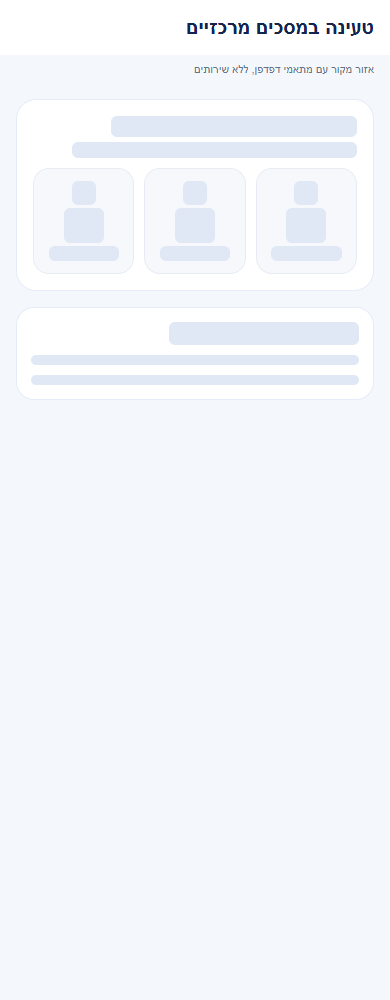
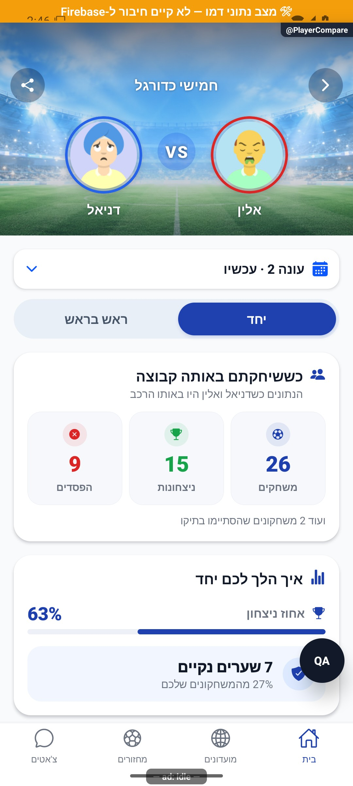
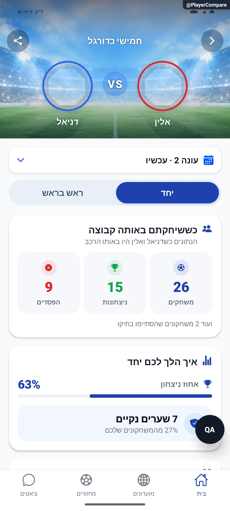
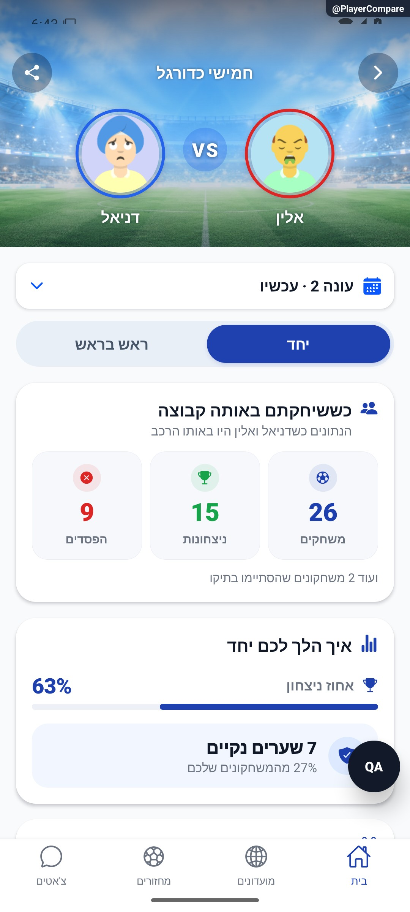
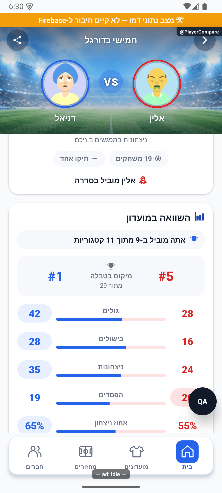
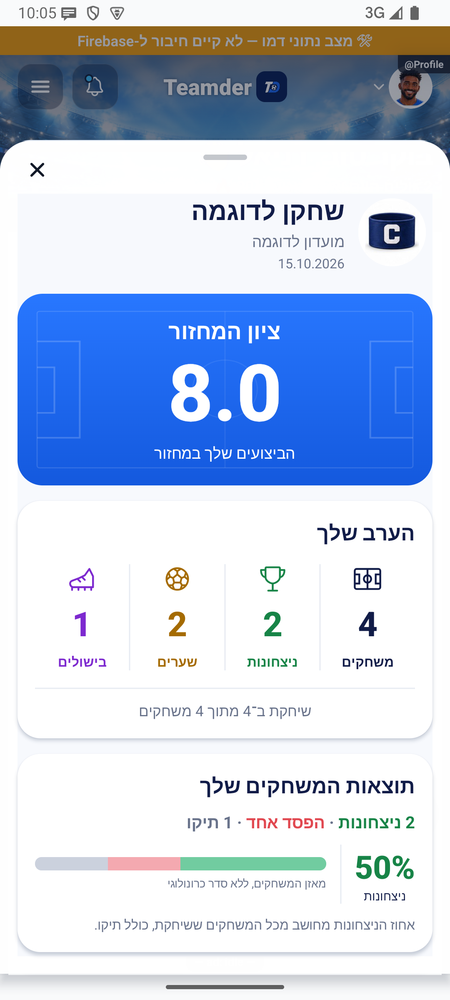
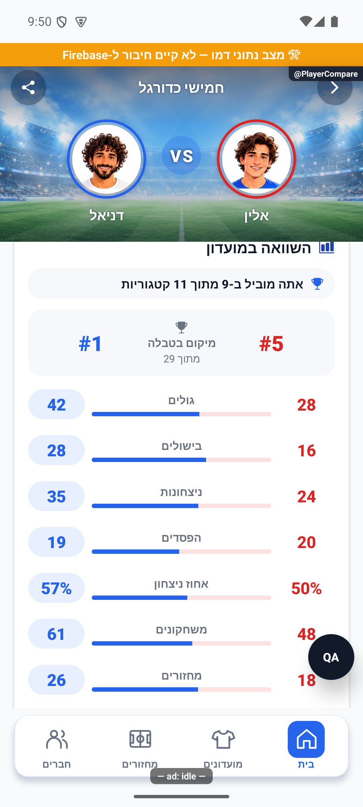

# השוואת שחקנים ושיתוף

## עצירת מחזור קבוע ללא פעילות, 6.11.2026

נבדק השינוי התחום ב-`functions/src/clubDeletion.ts`, `functions/src/index.ts`, `tests/logic/clubDeletion.test.ts`: בדיקת חוסר פעילות לפני יצירת מחזור קבוע ושמירת שלוש החלטות בזמן ניקוי מחזורים ריקים. ההכרעה משתמשת במקור הקיים לקיום מחזור ומגינה על מחזור עם הרשמה שנותר לא מוכרע. עסקאות היצירה והניקוי נשארות מוגנות מפני שינוי מקביל ומועדון חסר. אין שינוי מכוון בחישובים, במכנים, בהרשאות, בניווט או בפעולות העצמאיות האחרות של הפיצר הזה. בדיקות מקור השרת הורצו במאגר זיכרון; הפריסה הממוקדת של שני שירותי התזמון אומתה בייצור מול המקור שנבדק, ותועדה הרצת שירות חמש הדקות ללא שגיאות. אין בכך אימות חדש של המסך או של יתר פעולות הפיצר. [ההתנהגות, מסלול הנתונים, הבדיקות ומגבלות ההפעלה](../../changes/2026-11-06-inactive-recurring-rounds.md).

## דירוג בסיס לשחקן ללא דירוג, 6.11.2026

נבדק שינוי תחום במקורות המשותפים של הכוחות האוטומטיים: שחקן ללא דירוג מחושב כ-2.5 מתוך 5, וההסברים תואמים. דירוג מפורש נשמר. אין כאן אימות חדש של כל מצבי הפיצר העצמאי; השינוי מקומי וטרם הופץ. המקורות המשותפים שנבדקו בהפרש זה: `functions/src/index.ts`. [ההתנהגות, הבדיקות ומגבלות האימות](../rounds/draft-setup.md#דירוג-בסיס-לשחקן-ללא-דירוג-6112026).

## תיקוני לילה ובדיקת הפעולות, 5.11.2026

PlayerComparisonViewed נשלח אחרי קבלת מודל בהקשר החשבון, המועדון ושחקן היעד. PlayerCompareTabChanged נפרד מהאירוע הישן PlayerCompareOpened. המאגר comparisonVisits שומר ניסיון לכל צמד ומועדון לאורך ההרכבה. שתי זהויות המשוות לאותו יעד נבדקו כמבצעים נפרדים בחבילות comparisonActivityVisit ו-comparisonActivityServer. השינוי מקומי. [ראיות ומגבלות](../../audits/2026-11-04-system-night/product-measurement.md).

## מדידת פעולות ואמינות נתונים, 5.11.2026

במיפוי מקור הרכיבים המוזכרים במסמך נמצאו 7 נקודות מטפל ו-7 מזהי פעולה. הספירה מתארת קוד וכוללת רכיבים משותפים; אין לחבר אותה לספירות של מסמכים אחרים ואין לראות בה הרצת כל המסך. המדידה מפורטת לפי גבול פקד מקורי, פעולה עסקית ומצב חשבון. תשובה מאוחרת נבדקת מול בעל הפעולה, ומצב קיים או בקשה חוזרת אינם תמיד הצלחה חדשה. רשימת המקרים שהורצו ומגבלות המסד, המכשיר והכיסוי נשמרות [בדוח המדידה](../../audits/2026-11-04-system-night/product-measurement.md) ובדוחות המקושרים אליו. המימוש מקומי; לא בוצעה בדיקה חדשה של כל מצבי הפיצר.

## חיפוש שחקנים וזמני טעינה, 4.11.2026

שירות החיפוש, הכרטיס וגיוס הפנויים התעדכן. מסלולי התאימות של זהויות, סטטיסטיקה מלאה והזמנות ממשיכים לבדוק גישה. נקודת הכניסה מייצאת את מעדכן מפתח השמות הפרטי. אירוע זה דורש פריסה נפרדת. בדיקה זו תחומה למקור המשותף, ללא הרצה חדשה של כל המסך העצמאי. מימוש מקומי שטרם הופץ. [השינוי, המדידות והבדיקות](../../changes/2026-11-04-player-discovery-speed.md).

## ציר פעילות פרטי בפולס, 4.11.2026

בציר הפעילות, תשובת שרת על מצב הרשמה קיים אינה נספרת כהרשמה חדשה. קבלה ללא סימון יצירה מפורש מוצגת עם מגבלת אמינות.

נבדקו התוספות במקורות המשותפים לצורך ציר פעילות פרטי בפולס: דיווח ניווט והקשר, תיעוד ניסיון הרשמה ותוצאתו וגבולות זהות ומחיקת חשבון. התוספת היא תיעוד ברקע במקומות הנתמכים; אין מכך אימות חדש של כל מצבי הפיצר הזה או שינוי בחישוביו. מקומי וטרם הופץ או נפרס. [היקף, מקורות, בדיקות ומגבלות](../shared/usage-activity.md).

## השוואת העונה הנוכחית בלי המתנה לארכיון, 4.11.2026

ב-`src/screens/players/PlayerCompareScreen.tsx` הופרדה מוכנות הגדרות העונות ממוכנות רשימת הארכיון. `SeasonData.metadata` מתעד אם גבולות העונה נקראו, ו-`SeasonData.archive` מתעד בנפרד טעינה, הצלחה או כשל של רשימת העבר. המצב משויך למזהה המשתמש, מצב האורח והמועדון. `seasonsLoaded` מציין כעת שהגדרות העונות נקראו בהצלחה, ולא שרשימת הארכיון הושלמה.

| מצב | תלות לפני טעינת ההשוואה | תוצאה |
|---|---|---|
| עונה נוכחית | הגדרות המועדון נקראו בהצלחה | `pairCompareService.load` מתחיל בלי לחכות לרשימת העבר. הגעת הרשימה אחר כך מעדכנת את הבורר ואינה מפעילה שוב את ההשוואה. |
| כל העונות | הגדרות המועדון וגם רשימת ארכיון מוצלחת | מועברים מזהי הארכיון המלאים. אין התחלת סכימה בזמן שרשימת העבר עדיין נטענת. |
| עונות כבויות עם עבר | אותן תלויות של כל העונות | הבחירה האוטומטית נשארת `all`, גם כשמדובר בתקופות עבר שאינן עונות תחרותיות. |
| כשל רשימת עבר | תחום נוכחי אינו תלוי בה | ההשוואה הנוכחית נשארת זמינה. בתחום כל העונות מוצג מצב ההשוואה הלא זמינה הקיים, בלי לייצר רשימה ריקה חדשה ובלי לסכום נתונים חלקיים. |
| כשל הגדרות מועדון | הגבולות אינם ידועים | מוצג המצב הלא זמין הקיים. אין קריאת השוואה עם גבולות לא ידועים. |
| החלפת חשבון, מצב אורח, מועדון, שחקן יעד או תחום | מפתח ההקשר השתנה | מודל קודם מוסתר מיד. תשובות ישנות מתבטלות במחזור האפקט ואינן ממלאות את ההקשר החדש. |

`requiredArchive` ו-`requiredPastSeasons` נשארים זהים כל עוד התחום הנוכחי אינו זקוק לרשימת הארכיון. זה מונע החלפת תלות שתתחיל קריאה שנייה כשמופיעות אפשרויות העבר. מערך המזהים הריק שמועבר לתחום הנוכחי אינו תוצאת קריאת ארכיון ואינו משמש להכרזה שאין עבר; השירות אינו צריך רשימת עונות עבר עבור התחום הזה. עבור `all` נדרשת במפורש הצלחת קריאת הארכיון לפני העברת הרשימה. השירות עצמו ממשיך לקרוא ולאמת את המועדון מהשרת ולבדוק עקביות עונה כפי שהיה קודם.

`comparisonContext` ו-`loadedContext` מונעים הצגת מודל של תחום או זהות קודמים תחת הכותרת הנוכחית, וגם מונעים מתן אפשרות לשתף מודל כזה. רישום ביקור עדיין דורש מודל תקין, חשבון מלא תואם וביקור שלא נרשם; כעת נבדק גם שמצב הבקשה המקורי אינו אורח. אין שינוי במכנים, כיוון הצמד, טווחי הזמן או כללי הפרטיות. כשל חריג של שירות ההשוואה מסיים את הטעינה במצב הלא זמין הקיים.

עברו 42 בדיקות בחמש חבילות: `tests/logic/playerCompareParallelArchive.test.ts`, `tests/logic/comparisonActivityVisit.test.ts`, `tests/logic/pairCompareScopeIntegrity.test.ts`, `tests/logic/pairCompareRead.test.ts`, `tests/logic/compareHighlight.test.ts`. הבדיקות מפעילות את גוף רכיב המקור עם מחזור אפקטים ושירותים מבוקרים. בתרחיש השהיה מבוקר הגדרות המועדון הגיעו אחרי 200 אלפיות שנייה, ההשוואה ארכה 300, והארכיון הגיע ב-2200. ההשוואה הנוכחית הוצגה כבר ב-500, ונקראה פעם אחת בלבד גם אחרי הגעת הארכיון. אלו השהיות בדיקה מכוונות ולא מדידת מסד או מכשיר אמיתיים. בדיקות נוספות מכסות כשל ארכיון, גבולות חסרים, מעבר לארכיון כשהעונות כבויות והחלפות זהות ויעד. אין ממשק חדש, פריסה או אימות מכשיר במסגרת שינוי זה. צילומי המקור והבדיקות המשולבות נרשמים בדוח המשימה המרכזי.

## הפצה פנימית 1.1.74, 3.11.2026

עדכוני הלקוח ב-`src/components/loading/CentralSkeletons.tsx`, `src/screens/players/PlayerCompareScreen.tsx` כלולים בחבילה הפנימית 1.1.74/306. ארכיון המקור המקומי וחתימת החבילה אומתו מול החבילה שהחזירה גוגל. מקור הבסיס הוא `06417f6132f4c7636aaee25574354ed7722966b9` עם שינויים שלא נשמרו לגיט.

עברו 6864 בדיקות יישום, בדיקות טיפוסים, 360 בדיקות הרשאות בסדרה ו-38 בדיקות שרת במסד הדגמה. ההרשאות והשירותים הפעילים נשמרו, ללא הסבת נתונים או קידום לייצור. האימות החזותי הוא מצילומי המקור בדפדפן שכבר תועדו, ללא התקנה או הרצת הפיצר הזה במכשיר בגרסה החדשה. אין בכך הכרזה על הפצת שינויים אחרים המתועדים במסמך. [מקור, קבלות, תכולה ומגבלות](../../changes/2026-11-03-internal-1.1.74.md).

## הרחבת טעינת השלד במסכים מרכזיים, 3.11.2026

אזורי המקור המשויכים שנבדקו בדפדפן: `compare-together`, `compare-h2h`. השלד יושב בענפי ההמתנה הקיימים; סוגי השלדים נמצאים ב-`src/components/loading/CentralSkeletons.tsx`. מצבי כשל, ריק, פרטיות והחלפת הקשר נשארים נפרדים. אין שינוי בשירותים, בחישובים, במכנים או בהרשאות. ההמתנה ברענון לוח המנהל שומרת מידע שכבר התקבל עבור אותו חשבון ומועדון; בכרטיס האישי נשמר מנגנון הקריאה הקיים, לרבות איפוס חלקיו בתחילת ביקור.

מקורות משויכים שנערכו: `src/screens/players/PlayerCompareScreen.tsx`.

[טבלת המבנים, תנאי ההכרעה, מסלול הנתונים, הבדיקות והמגבלות](../../changes/2026-11-03-central-screen-skeletons.md). מקומי וטרם הופץ. האימות החזותי תחום לאזורי מקור עם מתאמי דפדפן, ללא אימות מכשיר או שרת חי חדש.

בדיקות במשימה זו: 6,831 בדיקות ב-609 חבילות ובדיקת טיפוסים עברו. נבדקו 25 מצבי מקור ב-162 בדיקות רוחב, ובוצעו תשע השוואות מידות לרכיבי תוכן. אין בכך אימות מכשיר חדש של הפיצר או של מצבים שאינם כלולים בדוח.

## תיקוני דיווחי הפולס, 3.11.2026

נבדק ההפרש התחום ב-functions/src/index.ts, באתר index:20a83f91b9 בלבד: קוד כפילות של joinCredited נבדק לפני observeCaughtError. הסמן וההגדלה נשארים אטומיים, ושגיאות אחרות נשארות נצפות. אין שינוי מכוון בחישובים, במכנים, בניווט או בהרשאות של הפיצר המתואר כאן. בדיקת הלולאה הממוקדת מתועדת ב-shared/data-and-state-contracts; אין כאן בדיקת מסך או מסלול ייצור חדש של הפיצר הזה.

[פירוט התיקונים, הבדיקות, הצילומים והמגבלות](../../changes/2026-11-03-pulse-sweep.md).

## העברת אורח לרשימת המתנה, 3.11.2026

נבדק ההפרש הממוקד במקור המשותף `functions/src/index.ts`: תנאי `guestSeatFreed` ב-`onGameRosterChanged` מבחין כעת בין הסרת אורח פעיל לבין העברה ידנית להמתנה. אין שינוי מכוון בחישובים, בנתונים, בניווט או בפעולות העצמאיות של הפיצר המתואר כאן. בדיקות גילוי העזיבה והקידום מכסות את השינוי המשותף; אין בדיקת מסך חדשה לפיצר זה. התיקון מקומי וטרם נפרס או הופץ.

[היקף, בדיקות ומגבלות](../../changes/2026-11-03-guest-waitlist.md).

## בקשות לשיחה אישית, 2.11.2026

נבדקה השפעת תוספת בקשות השיחה במקורות המשותפים. השינוי ממוקד בהרשאת שיחה, בשדות פרטיות ההודעות ובחיבורי הבדיקות; אין מכך אימות חדש של מסך זה במכשיר. המימוש מקומי וטרם הופץ או נפרס. [התנהגות, בדיקות ומגבלות](../chat/message-requests.md).

מקורות משותפים שנבדקו בהיקף השינוי הזה: `functions/src/index.ts`, `functions/src/socialPlayers.ts`. אין בסעיף זה טענה להרצת כל המסלולים ההיסטוריים של הפיצר. [מסירת המימוש](../../changes/2026-11-02-message-requests.md).

## הסרת מגבלת החברים במועדון, 1.11.2026

נבדקה השפעת השינוי הממוקד במקורות המשותפים: הוסרה מגבלת החברים במועדון. אין שינוי מכוון בהתנהגות העצמאית של המסך המתואר כאן או במספר המקומות במחזור. התיקון מקומי וטרם הופץ; אין בדיקת מכשיר חדשה לפיצר זה.

מקורות ששונו בהיקף המשימה: `functions/src/index.ts`, `functions/src/socialPlayers.ts`, `src/services/groupService.ts`. מספרי החברים אינם משמשים עוד כתנאי תפוסה במועדון. שדות התאימות הישנים אינם נאכפים.

[מסלול הנתונים, התנאים, התאימות, הבדיקות ומגבלות ההפצה](../../changes/2026-11-01-unlimited-club-members.md).

## פריסת הגנות הסרת המחזור, 30.10.2026

נפרסו שבע חבילות מבודדות, ועדכון המקור בלבד אומת מול כל הקבצים הפעילים. הגדרות השירותים והאירועים ו-111 השירותים האחרים נשמרו. אומתו מוכנות ותעבורה לגרסאות החדשות, קריאה עצמית עם חשבון בדיקות קיים ושימור גרסאות כל 496 המסמכים שבגיבוי. שש דחיות בקשות דפדפן לא תקינות סווגו לפי מזהי בקשה; לא זוהה כשל ריצה עסקי בלתי צפוי. לא הופעלו מחיקה, חסימת מחזור או בקשת שמירה תקינה על נתוני המועדון. זו ראיית הפריסה התחומה ולא הרצה מחודשת של כל מסך.

[גרסאות פעילות, בדיקות שרת וגבולות האישור](../../changes/2026-10-30-evening-removal-server-deployment.md).

## השלמת הגנת הסרת המחזור, 30.10.2026

הורחבה ההגנה ב-`functions/src/personalActivity.ts` וב-`functions/src/managerRoundHistory.ts`: קריאת `gameRemovalBlocksWrite` וקיום המחזור בתוך עסקת יצירת הנתונים. בקשת סנכרון לאחר הסרה מחזירה כשל מפורש במקום ניסיון חוזר ללא סוף. ב-`functions/src/index.ts` גם חבילת סטטיסטיקה מלקוח ישן מעדכנת את המחזור עם תנאי גרסה, ומכסת הפעולות כוללת תמיד כתיבת הגנה זו. אין שינוי בחישובי התוצאות, הפרטיות או הניווט מעבר להגדרת המחזור המתועד שפורטה קודם. נבדקו ארבעה עשר תרחישים ראשיים, שמונה תרחישי חסימה ושחזור, שמונה בדיקות חבילות ושבע בדיקות פעילות ונתוני מנהל במסד מקומי. ההיקף הוא בדיקת השינוי התחום במקורות משותפים, ולא הרצה מחודשת של כל מסך או של תשתית מסירת האירועים. התיקונים טרם נפרסו.

[תוכנית הביצוע, החבילות, הבדיקות וגבולות האישור](../../changes/2026-10-30-evening-removal-readiness.md).

## הגנה בהסרת מחזור היסטורי, 30.10.2026

השינוי התחום ב-`functions/src/index.ts` עוטף את עיבוד אירועי הסגל בזכות עיבוד כדי לסנכרן הסרה ניהולית עתידית; הוא מוסיף קריאת קיום מחזור בעסקאות של השלמת היסטוריה ושמירת פעילות. השינוי ב-`functions/src/socialPlayers.ts` משווה את הגדרת המחזור המתועד לחישוב העצמי. אין שינוי מכוון בפעולות העצמאיות האחרות המתועדות כאן, בהרשאות או בניווט. זו בדיקת השפעה תחומה של המקורות המשותפים, ולא הרצה של כל מצבי הפיצר. אין פריסה או אימות מכשיר חדש.

[התנהגות, סדר הפעולות, חישובים, בדיקות וגבולות האישור](../../changes/2026-10-30-evening-removal-readiness.md).

## תלות בסינון הצעות השלמה - 28.10.2026

השינוי הנוכחי ב-`functions/src/index.ts` מוגבל לבחירת הצעות השלמה: סף תפוסה של 70 אחוז ובדיקת הרשמה מתנגשת לפני יצירת התראה. אין שינוי מכוון בתהליך העצמאי המתואר כאן ואין אימות חדש שלו. רענון המקור המשותף אינו מאמת שינויים קודמים שהיו בו מאז קליטת התיעוד. [היקף, בדיקות ומגבלות](../../changes/2026-10-28-filler-eligibility.md). מקומי וטרם נפרס.

## הרחבת אבחון דיווחים, 27.10.2026

נוספה מעטפת אבחון מקומית עם מצב בזמן הכשל, שלבים בעלי מזהה ותזמון, מצב רשת ובנייה ומופעים נפרדים לשגיאה. נקודת הכניסה לתעבורת השרת עוברת כעת דרך העטיפה המשותפת; תשובות, חריגות, אפשרויות קריאה ומדיניות הפיצר נשמרות. אין כאן שינוי בהרשאות או בחישובי המוצר. הבדיקות המלאות ומגבלות האימות מתועדות בדוח המקושר; אין טענה לאימות מכשיר או להפצה. [היקף, ראיות ומגבלות](../../changes/2026-10-27-diagnostic-context.md).

באימות הסופי עברו כל 6,231 הבדיקות ב-555 חבילות, ובדיקות הטיפוסים של הלקוח, השרת והפולס נקיות. צילום הדפדפן והידור מקורות האנדרואיד הם בדיקות מקומיות; אין הוכחת מכשיר, הידור אייפון או מסירה חיה של הבנייה החדשה. רישום יומן השחרור נחשב מאומת רק לפי קבלת הקריאה החוזרת בדוח השינוי.

## טיפול מלא בפריטי הפולס הפתוחים, 27.10.2026

נבדק השינוי הממוקד במקור המשותף: התנגשות גרסת מועדון בעת זקיפת השתתפות נשלחת כעת לניסיון חוזר מקומי מוגבל שבונה מחדש את אותה כתיבה ואת הגנת העונה. סמן מניעת הכפילות נשמר. אין שינוי בהרשאות, בניווט או במדיניות הפיצר הזה. אין אימות מכשיר חדש או פריסה. [ממצאים, בדיקות ומסירה](../../changes/2026-10-27-pulse-completion.md).

## שלמות טווח ההשוואה, 27.10.2026

`pairCompareService.load` ב-`src/services/pairCompareService.ts` קוראת את המועדון מהשרת לפני נתוני ההשוואה. מועדון חסר, כשל מטא נתונים או `seasons.operation` אינם מתפרשים כעונה כבויה. אחרי קריאת הטבלאות, הזוג והנוכחות נקרא המועדון שוב מהשרת, ונדרשת אותה `seasonReadStamp` ללא פעולה ממתינה. שינוי עונה בזמן הקריאה גורם למנגנון הכשל הקיים להחזיר השוואה לא זמינה, במקום לפרסם נתונים מעורבים. אין ניסיון חוזר אוטומטי נוסף; הקריאה התקינה מוסיפה קריאת מועדון אחת.

בטווח כל הזמנים, דרישת מספר הארכיונים ותקופות שאינן עונה נבדקת מול `group.seasons` העדכני, ולא מול עותק המסך שיכול להתיישן. קריאות זהות שחקן נשארות אופציונליות לצורך שם ותמונה בלבד. אין שינוי בנוסחאות, בתצוגה, בניווט או בהרשאות.

חמש בדיקות ב-`tests/logic/pairCompareScopeIntegrity.test.ts` נכשלו מול המקור הקודם, ואחרי התיקון עברו: כשל מועדון אינו גורם לסריקה ללא עונה, חסימת נתונים בזמן פעולת עונה, שינוי עונה בין הקריאות, ארכיון חסר מול מספר מסך ישן, והשוואה תקינה עם שתי קריאות שרת. הדוגמה התקינה היא 6 שערים בשלושה מחזורים וממוצע 2, ולא 6 מתוך 20 מחזורי קריירה. יחד עם קורא הזוג, כיווני הזוג והגנת השגיאות עברו 31 בדיקות. אלו בדיקות שירות עם מתאמים מבוקרים, ללא הרצת מסך חדשה; [תוצאות הבדיקה המלאה](../../changes/2026-10-27-overnight-audit.md). תיקון לקוח מקומי שטרם הופץ.

## טיפול בתקלות הפולס, 26.10.2026

השינוי במקור המשותף מוגבל לסיווג תוצאה צפויה לפני רישום שגיאה: תיעוד מחיקת מחזור שכבר קיים אינו כשל חדש, והתנגשות גרסה בעדכון עונה אינה מבטלת את הגנת הגרסה. אין שינוי בחוזה הפיצר, במכנים, בניווט או בהרשאות; לא נערכה הרצה חדשה לכל מצבי הפיצר. כשל לא צפוי בתיעוד מחיקה נזרק שוב כדי לאפשר ניסיון שרת חוזר.

השינוי מקומי וטרם הופץ. [בדיקות, מסירה ומגבלות](../../changes/2026-10-26-pulse-fixes.md).

מקורות שנבדקו בסבב: `functions/src/index.ts`.

## ביטול פעילות אחרי מחיקת מועדון - 26.10.2026

נבדקה השפעת השינוי התחום ב-`src/services/groupService.ts`, ב-`src/services/seriesService.ts` וב-`functions/src/index.ts`: עצירת סדרות לפני מחיקת מסמך ההרשאה, הפעלת ביטול פעילות באירוע מחיקת המועדון, ועסקאות יצירה שמאמתות את קיום המועדון והסדרה גם במנגנון ההעתקה הישן. `functions/src/clubDeletion.ts` שומרת מחזורים שהסתיימו ונתוני עבר, מבטלת מצבים פעילים, דוחה בקשות חברות ממתינות, מסירה רק את המועדון שנמחק מהרשמות להתראות ומסירה את ההעתק הציבורי. המימוש והבדיקות ב-`tests/logic/clubDeletion.test.ts` וב-`tests/logic/clubDeletionClient.test.ts` מפורטים ב[דוח התיקון](../../changes/2026-10-26-deleted-club-recurring.md). אין שינוי מסכים, ניווט, נוסחאות או הרשאות במסגרת תיקון זה. זו בדיקת השפעה ממוקדת ואינה אימות מחודש של שינויים קודמים במקורות המשותפים. תיקון השרת נפרס ואומת באישור הבעלים, עם השוואת המקור הפרוס והקוד המהודר ושימור יתר הפונקציות. הסדרה, הרשמת ההתראות והכרטיס הציבורי של המקרה הידוע טופלו ונקראו חזרה; המחזור כבר היה חסר בבדיקה העדכנית. שינוי הלקוח טרם נכלל בבינארי. סעיף הפריסה בדוח כולל את מגבלות בדיקת החבילה המבודדת, ללא טענה למחיקת מועדון בדיקה בייצור.

## השפעת מקור משותף במשימת השעון - 26.10.2026

נבדקה תוספת הייצוא ב-`functions/src/index.ts`: ארבע הפעולות `onGamePersonalActivityChanged`, `savePersonalActivity`, `getMyPersonalActivity`, `onPersonalActivityOwnerDeleted` מחוברות למסלול נפרד של יומן השתתפות ומדידה אישית. הסרת שורת הייצוא לצורך השוואה בלבד משחזרת את חותמת המקור שנרשמה לפני המשימה, ולכן תוספת זו היא ההבדל הממוקד שנבדק כאן. נתוני הפעילות הפרטיים אינם מתווספים להשוואת השחקנים או לתמונת השיתוף בעקבות הייצוא. זו בדיקת השפעת השינוי התחום במקור המשותף, ולא הרצה מחודשת של כל מצבי הפיצר. השינוי מקומי; מסמך זה אינו מאשר פריסה, שינוי הרשאות או העלאה לחנות. הצילומים בסיכום האישי מבוססים על רכיבי המקור עם מתאמי דפדפן ונתוני בדיקה, ולא על הרצת אנדרואיד או שעון. [היקף המימוש, הבדיקות, מגבלות האישור והצילומים](../../changes/2026-10-26-android-personal-activity.md).

## הפצה פנימית 1.1.61 - 25.10.2026

הבינארי `1.1.61/295` הופץ ואומת במסלול הפנימי באנדרואיד. תיקוני הלקוח נכללים בו, ושירות הפרופיל נפרס ואומת בנפרד. גם תיקוני הסגל, שמירת התוצאה והתראת השגיאה בשרת נפרסו ואומתו באישור מפורש. שינויי יישום הפולס עצמו טרם הופצו. אין שינוי כללי הרשאה או הסבת נתונים. ניסוחי המצב המקומי בסעיפים הקודמים נכתבו לפני ההפצה; [דוח ההפצה](../../changes/2026-10-25-internal-1.1.61.md) מפרט בדיוק מה נכלל, מה נבדק ומה עדיין מקומי.

## תיקוני הפולס - 25.10.2026

נבדקה השפעת שינוי המקור המשותף: `functions/src/index.ts`. השינוי מוגבל לטיפול בדחיות צפויות, ניסיונות קריאה חוזרים או רכיב חזותי משותף, כמפורט בדוח הסבב. אין שינוי נוסף בחוזה התהליך המתואר כאן, במכנים, בזכאות או בהרשאות; לא נערכה הרצה חדשה של כל מצבי הפיצר.

[מקורות, בדיקות, צילומים ומגבלות](../../changes/2026-10-25-pulse-fixes.md).

## שעון מדויק וכיתוב פנדל - 25.10.2026

במקורות המשותפים נוסף שימור השעון המדויק של פנדל במהלך משחק, וכיתוב ההבקעה ביומן קוצר. אין שינוי במונים או בתהליך העצמאי המתואר כאן; לא נערכה לו בדיקת ממשק חדשה במסגרת העדכון. השינוי מקומי וטרם הופץ. [פרטים וראיות](../../changes/2026-10-25-in-play-penalties.md#שעון-מדויק-וכיתוב-אירוע).

## פנדל במהלך משחק חי - 25.10.2026

נבדק השינוי הממוקד במקורות המשותפים: נוספו חוזי אירועי פנדל במהלך משחק, קוראים ומוני סטטיסטיקה, והגנות בעסקאות סיום ואיפוס משחק. מסלול הפיצר המתואר כאן אינו נקודת הכניסה להזנה החדשה. בדיקות המאגר עברו, אך אינן הוכחת הרצה חדשה של כל מצבי התהליך או של פריסה.

השינוי מקומי. נדרשת פריסת שרת לפני הפצת לקוח שמשתמש באפשרות; לא בוצעו פריסה או שינוי הרשאות. [חוזה הנתונים, התהליך, הבדיקות ומגבלות ההפצה](../../changes/2026-10-25-in-play-penalties.md).

## יציבות בדיקת סדר העסקאות בלילה של 25.10.2026

בהרצת כל הבדיקות נמצא שהתרחיש `an older transaction cannot regress newer comparison context or remove its day bucket` ב-`tests/logic/comparisonActivityServer.test.ts` תלוי בתאריך ההרצה. בליל המעבר לשעון חורף, הוספת 24 שעות עלולה להישאר באותו תאריך בירושלים; מפת המבחן הכילה אז שני מפתחות זהים והציפייה לשני ימים נכשלה. המבחן קובע כעת שעון ידוע ב-20.10 בצהריים ומחזיר אותו לאחר התרחיש. התנאים והפעולה הנבדקים נשמרו; לא שונו חישובי ימים או קוד מוצר כחלק מתיקון הבדיקה. 22 בדיקות החבילה עברו. [תוצאות החבילה המלאה ומגבלות](../../changes/2026-10-24-loading-performance.md).

## עדכון הפצה פנימית — 24.10.2026

נכלל בגרסה הפנימית `1.1.59/293`, ממקור `7c6f98e`. שני שירותי היסטוריית ההשוואות ועדכון הצבעים בשני נתיבי החלוקה המתוזמנת נפרסו ואומתו. אין היסטוריית השוואות ישנה; רק לקוחות חדשים מתעדים ביקורים. הייצור בחנות נשאר `1.1.57/291`, והכללים נשמרו לתאימות. טענות ״מקומי״ או ״טרם הופץ״ בהמשך מתארות את שלבי הפיתוח שקדמו להפצה זו. [מקור, בדיקות, פריסה ומגבלות](../../changes/2026-10-24-internal-1.1.59.md). אין בסבב זה אימות ממשק או התקנה חדשים.

## רישום השוואה והיסטוריה לבעל הכרטיס — 24.10.2026

מקומי, מעל `2f93005a9716313a470285c4d77f0ccad3c19f44` ושינויים מקומיים קודמים. אין פריסה או הסבת נתונים. לא שונו `firestore.rules` או מדיניות הגישה לנתוני ההשוואה הקיימים. ההיסטוריה אינה קיימת כיום כמאגר שימושי, ואירוע החלפת הלשונית הישן אינו משוחזר לביקורים.

### מסלול כתיבה והסרת כפילויות

`src/screens/players/PlayerCompareScreen.tsx` רושם ביקור רק אחרי `pairCompareService.load` שחזר עם מודל תקין, כל עוד הבקשה עדיין פעילה וזהות החשבון נשארה זהה. אורח, השוואה לעצמו, כשל טעינה או ניסיון ישן אינם נרשמים. לכל שילוב בעלים–מועדון–יעד במופע המסך נוצר `visitId` אחד באמצעות `expo-crypto.randomUUID`. המפה מחזיקה מצב שליחה ומצב סיום. החלפת לשונית, החלפת תקופה, טעינה חוזרת או תשובת שרת חוזרת אינם ביקור נוסף באותו מופע. כשל דיווח אינו חוסם את הצגת ההשוואה; ניסיון נוסף באותו מסך משתמש באותו מזהה. פתיחה חדשה של מופע מסך מקבלת ביקור חדש. זהו תיעוד הצלחת הטעינה בלקוח, ולא הוכחה שהאדם קרא כל נתון.

`src/services/comparisonActivityService.ts` מפעיל את `recordPlayerComparison` עם זהות צפויה, מזהה יעד, מזהה מועדון, מזהה ביקור ותקופה ראשונה שהושלמה בביקור. ניסיון חוזר באימות משתמש באותו מטען. טקסטי מועדון, זהות המשווה, זמנים ומונים אינם מתקבלים מהלקוח.

`functions/src/comparisonActivity.ts` מייצא את `recordPlayerComparison` ו־`getMyComparisonActivity`; `functions/src/index.ts` מוסיף את שורת היצוא שלהם בלבד במסגרת משימה זו. שתי הפעולות דורשות חשבון מלא ומפעילות את מדיניות בדיקת היישום הקיימת. זהות המשווה נגזרת מהאסימון. הכתיבה בודקת בתוך עסקה מסמכי משתמשים, חברות נוכחית של שניהם במועדון, מועדון שאינו אישי או מחוק, חסימה בשני הכיוונים, קבלת ביקור, סיכום משווה ומגבלת קצב. מועדון או יעד שאינם תואמים אינם מייצרים אירוע. השוואת ארכיון מחייבת מסמך `seasonSummary` של המועדון. שחקן שעזב את המועדון יכול עדיין להופיע בנתוני ההשוואה ההיסטוריים הקיימים, אך אינו מקבל ביקור חדש במסלול הזה כשהוא אינו חבר נוכחי — אין להרחיב הרשאות כדי לייצר רשומת היסטוריה.

### אחסון, ספירה ויחידות

ב־`playerComparisonActivity/{targetUid}/visits/{hash}` נוצר מסמך קבלה בלתי משתנה. המפתח הוא גיבוב של המשווה ומזהה הביקור בתוך ענף היעד. באותה עסקה מתעדכן `playerComparisonActivity/{targetUid}/viewers/{viewerUid}` עם `total`, מפת `days` ל־30 תאריכים, `lastAt`, `lastGroupId`, `lastGroupName`, `lastScope`. הקבלה, הסיכום ומגבלת הקצב נשמרים יחד; קבלה קיימת מחזירה `recorded:false` ללא תוספת למונה. אין כתיבה ישירה מהלקוח לאוספים החדשים, והם אינם תואמים שום מסלול הרשאה בכללים הקיימים; הקריאה עוברת דרך הפעולה המאומתת בלבד.

״השוואה״ היא ביקור מוצלח אחד במסך השוואה, ולא מחזור, משחק או החלפת לשונית. `total` הוא מספר הביקורים לכל הזמנים. ״30 ימים״ הם היום בירושלים ו־29 הימים הקלנדריים שלפניו; המפתחות בתבנית `YYYY-MM-DD` נוצרים לפי `Asia/Jerusalem`, ותחילת הטווח מחושבת על תאריך בלי להניח שיום תמיד מכיל 24 שעות. שינוי שעון אינו מזיז יום לתקופה אחרת. ברישום חדש נשמרים רק מפתחות הימים הרלוונטיים, בלי לאפס את `total`. במצב חודש סוכמים רק מפתחות בטווח, ובכל הזמנים משתמשים ב־`total`.

`getMyComparisonActivity` בוחר את ענף היעד לפי אסימון הבעלים; בקשת מזהה אחר נדחית. נקרא סיכום אחד לכל משווה, ולא כל מסמכי הביקורים. השורות מסוננות לסכום חיובי בטווח; זהויות מתעדכנות בקריאה קבוצתית, ומשווים שנמחקו, הפכו לאורחים או חסומים באחד הכיוונים מוסתרים מהשורות ומהסכומים. מספר שחקנים = מספר המשווים הגלויים השונים; מספר השוואות = סכום המונים שלהם. לדוגמה 6 שחקנים ו־14 ביקורים אינם 14 אנשים. המונים מחושבים לפני חלוקת העמודים, ולכן עמוד ראשון בן 30 שורות אינו מקצץ את המכנה. המחיר הוא קריאת סיכומי כל המשווים וטיפול בזהויות, ולא עלות קבועה של עמוד בודד.

מיון לפי תאריך אחרון יורד ואז מזהה עולה. כל עמוד מחזיר עד 30 שורות וסמן קשור לבעלים, לתקופה ולמפתח המיון האחרון. הסמן אינו מקנה גישה לענף אחר. תזוזת רשומה כתוצאה מביקור חדש בזמן דפדוף יכולה לשנות מיקום בין עמודים; הלקוח מסיר כפילויות, ורענון מחזיר סדר עדכני. אין הבטחת תמונת מסד קפואה לאורך דפדוף חי. הרישום מוגבל ל־30 ביקורים חדשים בדקה והקריאה ל־60 בדקה, לכל חשבון. קבלה כפולה אינה צורכת ספירה נוספת של כתיבה חדשה. חסימת קצב או כשל נשארים שגיאה ולא תשובה ריקה.

זמן השרת מחושב מחדש בכל ניסיון עסקה. ביקור שמגיע בסדר הפוך אינו מחזיר לאחור את תאריך הביקור האחרון או את פרטיו, ואינו מחזיר דלי ימים שכבר יצאו מהחלון; המונה הכולל עדיין מתקדם. התנהגות זו מכוסה בבדיקת רגרסיה.

### ממשק, ניווט וכתיבה

`src/components/profile/ComparisonActivitySection.tsx` נטען רק בכרטיס עצמי, אחרי המחזור האחרון. הרשימה המלאה היא חלון בתוך הכרטיס, בלי מסלול ניווט נוסף. אין סקשן בכרטיס הציבורי או בתמונה לשיתוף. שלוש שורות תצוגה מקדימה אינן חייבות להסתכם למונים של כל המשווים; הכותרת מתייחסת לכל הרשימה בתקופה. פרטי שורה מתארים את הביקור האחרון, בעוד הכמות מתייחסת לכל ביקורי אותו שחקן בתקופה, גם בכמה מועדונים. אין שינוי בהרשמה, תוצאות, עונות או נתוני משחקים.

### אימות והפצה

41 בדיקות ייעודיות בארבעה קבצים — `tests/logic/comparisonActivityServer.test.ts`, `tests/logic/comparisonActivityVisit.test.ts`, `tests/logic/comparisonActivityService.test.ts`, `tests/logic/comparisonActivityLoading.test.ts` — מכסות זהות וגישה, קבלה כפולה, גבולות חודש בירושלים, סיכום 41 משווים מעבר לעמוד הראשון, חסימות, כשלים, טעינה מוצלחת מול כושלת וביטול תשובות ישנות. קוד השרת מורץ בבדיקות מול מדמה מסמכים ועסקה, לא מסד ייצור או אמולטור פיירסטור. בדיקות טיפוסים ללקוח ולשרת נקיות. כל 494 חבילות הבדיקה ו־5,605 הבדיקות עברו.

באימולטור אנדרואיד נצפו הכרטיס והרשימה המלאה, והבחירה ״כל הזמנים״ שינתה את נתוני הדמו מ־6 שחקנים/14 השוואות ל־7/19. [כרטיס](../screenshots/comparison-activity-card-2026-10-24.png) · [רשימה מלאה](../screenshots/comparison-activity-all-2026-10-24.png). אין בראיה זו כתיבת ביקור אמיתית, בדיקת אייפון, גופן מוגדל או בדיקת קצב ברשת. הצילומים הקודמים של הכרטיס משמשים רק רקע; לא צולם מקטע ״לפני״ חדש לפני עריכת הקוד, ואין להציג סקיצה כהוכחת הרצה.

נדרשת פריסה נפרדת ומאושרת של שתי הפונקציות יחד עם הלקוח כדי להתחיל איסוף בייצור. פריסה לא בוצעה, הכללים לא נערכו, אין הסבת עבר ואין איסוף מחוץ לאירועים החדשים. [דוח השינוי, מקור העיצוב והמסירה](../../changes/2026-10-24-comparison-activity.md).

## תיעוד כשלים — 20.10.2026

נוספו תצפיות דיווח בנקודות הכשל של המקורות המשויכים לפיצ׳ר, במסגרת הרחבה רוחבית. נשמרו ערכי החזרה, הזריקות ותנאי הפעולה הקיימים; נוסף מקור קוד והקשר לדיווח. כיסוי תחבירי אינו הוכחת הרצה של כל מצב. השינוי מקומי וטרם הופץ; בדיקות המסירה, מגבלות מניעת הכפילויות והמסלולים שטרם חוברו מתועדים בדוח המשותף.

[דוח דיווח השגיאות והראיות](../../changes/2026-10-20-error-reporting-audit.md).

## תיקון טעינת צמד חסר — 12.10.2026

`readLivePair` ב־`pairCompareService.ts` מבצע שאילתה מוגבלת לתוצאה אחת לפי `groupId` ושדות `a`, `b` בסדר מזהים ממוין. גם מסמך ישיר וגם שאילתת שוויון על `documentId()` נכשלו באמולטור כשהמסמך חסר, מפני שהכלל מבוסס על `resource.data.groupId`. סינון השדות מחזיר אפס תוצאות תקין לחבר המועדון; זר נשאר חסום. אין תפיסת שגיאת הרשאה והמרתה לאפסים, ואין שינוי כללי הרשאות, חישובים, מכנים, ניווט או עיצוב. השדות נכתבים הן באיסוף הבישולים והן בסיכום המחזור.

הקריאה משותפת לטווח הפעיל ולאיחוד כל הזמנים; עונה סגורה ממשיכה להיקרא מהארכיון. היעדר נתוני צמד אינו מכשיל את הנתונים האישיים של השניים. נבדקו השירות בבידוד והשאילתה מול מלוא הכללים באמולטור: צמד קיים, צמד חסר וזר בשני המצבים. נתוני חשבון ייצור לא הורצו דרך הממשק; אין צילום חדש מפני שאין שינוי חזותי. ראיות ומגבלות: [דוח השגיאות](../../audits/2026-10-12-pulse-errors.md). התיקון מקומי וטרם הופץ.

[להסבר הקצר והפשוט](player-compare.simple.md)

עדכון 10.10.2026: תוויות התיקו, אחוז הניצחון ללא תיקו ואחוז השערים הנקיים נקראות כעת ״משחקים״ ביחס למשחקונים בתוך מחזור, ולא כמחזורים שלמים. באותו מועד לא שונו המכנים; החלטת הבעלים מ־13.10.2026 מחליפה את מכנה הניצחונות בכל המשחקים, כולל תיקו. השירות הישן `playerCompareService` מסומן במפורש כהיסטורי; מקור המסך הוא `pairCompareService`. שינוי הנוסח נבדק בקוד ובבדיקות השפה, ללא צילום חדש של חלון ההסבר בסבב זה.

עודכן: 07.10.2026; מקור: `8e8fde5`. מסך `src/screens/players/PlayerCompareScreen.tsx`; מסלול `PlayerCompare` עם `groupId`, `otherUid` ושם אופציונלי, מתוך סגל או פרופיל שחקן בהקשר מועדון.

## מבנה

רקע אצטדיון בהיר, שני אנשים, בחירת חלון עונה, לשוניות ״יחד״ ו״ראש בראש״ ושיתוף. הצופה בכחול משמאל פיזית, האדם האחר באדום מימין פיזית; סדר הילדים מותאם ל־`forceRTL`. אין להסיק מי הצופה מהשם בתצלום בלבד.

״יחד״: משחקונים משותפים באותה קבוצה, ניצחונות/הפסדים, תיקו, אחוז ניצחון ושערים נקיים. בישולים כיווניים מוצגים כשיש נתון מתאים. אין סכום ״כל השערים שכבשתם יחד״ שנגזר אוטומטית ממוני החיים.

״ראש בראש״: מפגשים בקבוצות מנוגדות, ניצחונות השניים ותיקו, ובהמשך השוואת המספרים של כל אחד במועדון בטווח שנבחר — שערים, בישולים, תוצאות, אחוז ניצחון, משחקונים, מחזורים ומדדים מותנים כגון שער נקי ופנדלים. הסטטיסטיקה האישית בטווח אינה בהכרח רק המפגשים ביניהם. דירוג הוא סדר ולא גודל פס.

| פעולה/מצב | מקור | התנהגות |
|---|---|---|
| החלפת טווח | חי/ארכיון/איחוד | אותם חלונות בנתוני הצמד ובנתוני השחקנים |
| אין משחקונים יחד | צמד ריק בחלון | הסבר במקום שישה כרטיסי אפס |
| אין ראש בראש | אין מפגשים מול | אינו מבטל נתונים אישיים במועדון |
| שיתוף | מודל שיתוף וצילום רכיב מחוץ למסך | כולל כותרת הטווח, שני שמות והמספרים שבמודל |
| תקלה/ארכיון חסר | שירותי ההשוואה | אין גיבוי מנתון גלובלי תחת שם מועדון |

## הגדרות ותלות

`src/services/playerCompareService.ts`, `pairCompareService.ts`; `src/utils/pairOrientation.ts`, `statsScope.ts`; `src/components/compare/PlayerCompareCard.tsx`; רכיב השיתוף והנכס הייעודי של האצטדיון. המזהים הממוינים הם מקור כיוון ניצחונות ובישולים. מ־13.10.2026 המכנה של אחוז הניצחונות הוא כל המשחקים, כולל תיקו; אפס משחקים אינו אחוז אפס.

בדיקות: `tests/logic/pairOrientation.test.ts`, `seasonArchivePairs.test.ts`, `shoshiChemistryScopes.test.ts`, `seasonScopedStats.test.ts`. צילום השיתוף נוצר מרכיב שנמצא מחוץ למסך אך עדיין מרונדר; `display:none` ישבור צילום. אין לערבב בין מודל השיתוף לבין קריאת נתונים נוספת ששינתה טווח.

## ראיות והיסטוריה

הצילום מציג ״יחד״ בנתוני דמה: 26 משחקונים, 15 ניצחונות, 9 הפסדים ו־2 תיקו; אין אימות מספרי השרת. לשונית ראש בראש, החלפת עונה, שוויון, מידע חסר וגיליון שיתוף לא צולמו כאן. מקורות 086/090 מתעדים תיקוני כיווניות; שימוש היסטורי ב־`row-reverse` אינו הוראה לשחזר אותו.

## הצעות בלבד

להסביר בהקשר הראש בראש את ההבדל בין המפגשים ביניהם למספריהם במועדון; להנפיש מעבר פסי השוואה רק אחרי שינוי טווח מאומת; להפחית תנועה כשאין מדגם, ולא להציג אדם כ״מנצח״ בגלל מדד שבו מספר קטן עדיף ללא הגדרה.

## פירוט טכני נוסף — זרימה, חישוב ונקודות שינוי

`pairCompareService.load` הוא מקור המסך הנוכחי; `playerCompareService` הישן אינו מקור חלופי לערבוב. הקורא טוען רק `communityPairStats/{groupId}__{pairKey}` לצמד הנבחר; בעונת עבר הוא משתמש בארכיון ובמצטבר מחבר חיים וארכיונים. `orientPair` הופך כיוון ניצחונות ובישולים לפי הצופה, בלי לשנות מונים סימטריים.

`winPct` מחלק בניצחונות+הפסדים ומוציא תיקו: 15 ניצחונות, 9 הפסדים ושני תיקו נותנים 63% לאחר עיגול, ולא 58%. אחוז שער נקי כן מחלק בכל 26 יחד. ממוצע שערים למחזור מחלק ב־`games` של ערבים: 10 שערים ב־4 ערבים הם 2.5, בלי קשר למספר המשחקונים. אין תוצאה מוכרעת נותן אחוז `null`.

**תיאור היסטורי שהוחלף בתיקון 8.10.2026:** `row` נותן יתרון לערך המספרי הגבוה גם בשורת הפסדים; זה תיאור הקוד הקיים, ולא טענה שיותר הפסדים הם רצויים. הסיכום סופר שורות עם יתרון, והשוויון אינו נותן נקודה; שורות נקיים ופנדלים מתווספות רק אם לפחות לאחד יש ערך חיובי. דירוג נקרא מאותו טווח באמצעות `comparePoints`; שחקן ללא שורה מקבל `played=false` וערכי `null`. קריאת צמד שנכשלה חוזרת כלא ידוע, ולכן אין לראות בכך הוכחה שלא שיחקו יחד. שינוי כלל יתרון או מכנה מחייב בדיקת המסך וכרטיס השיתוף מאותו מודל.

הפירוט מתאר את הקוד שנקרא, ולא בדיקת כתיבה או הרשאות בסביבת הייצור. יש לקרוא את הקוד הממוקד וההפרש מאז מקור המיפוי לפני תיקון; בדיקות המוזכרות כאן לא הורצו מחדש לצורך עריכת התיעוד.

## תיקוני סבב הבאגים — 8.10.2026

B05, R01: pairCompareService.row ו־mockPairCompare משוות losses בכיוון קטן יותר; 2 מול 10 נותן יתרון לשחקן עם 2. קריאות צמד מפיצות שגיאה, ומקורות championship ו־communityStats נקראים עם strict:true; הכשל מגיע למצב שגיאה במקום אפסים. אין שינוי במכנים או בטווחי העונות.

[ראיות, בדיקות ומגבלות](../../changes/2026-10-08-audit-fixes.md).

מצב יחד בדמו; כלל פחות הפסדים נבדק במודל ולא מוצג בחלק המצולם.

## השלמת הנפשות — 8.10.2026

PlayerCompareScreen עוטפת את גוף ההשוואה שאחרי הבורר ב־ChangeMotion לפי scope.k, season.id ו־loading במשך 220 אלפיות שנייה. style.gap=BLOCK משמר את הרווח המקורי בין הכרטיסים. SeasonScopeBar משותפת למסך המועדון. אין שינוי ב־pairCompareService, orientPair, בכיוון יתרון losses, במכנים או בכרטיס השיתוף. צילום מצב יחד בעונה הנוכחית נבדק; החלפת טווח בהשוואה וכשל מקור נתונים לא הורצו בסבב זה.

[פרטי האימות והמגבלות](../../changes/2026-10-08-motion-completion.md). מקור: `9ec0dfd` עם שינויים מקומיים; טרם פורסמה גרסה.

## תיקון דיווח פולס — 11.10.2026

`CompareBar` עוטפת כל מספר ב־`View` עם `cmpBadge`: רוחב מזערי 64, גובה מזערי 34, רדיוס 17 ומרכוז. רק המוביל מקבל `cmpLeadA/B`; שוויון ומידע חסר אינם מודגשים. הרקע עבר מהטקסט למעטפת כדי למנוע צורה לא אחידה ויישור צדדי באנדרואיד. אין שינוי במקור הנתונים, ההכרעה או החישובים. רכיב השיתוף אינו משתמש ברקעים האלה ואינו מושפע.

נבדקו תצוגת ראש בראש וכיווניות באמולטור אנדרואיד בנתוני דמו; נתוני ייצור ואייפון לא נבדקו.

## החלטות הבעלים — 13.10.2026

אחוז הניצחון כולל גם משחקים שהסתיימו בתיקו. שני ניצחונות, הפסד ותיקו הם 50%. נתוני כל הזמנים כוללים גם תקופות שבהן העונות היו כבויות.

`winPct(wins,losses,ties)` מחלק בסכום שלוש התוצאות; צמד משתמש בתיקו בכיוון המתאים. בשורות שחקן תיקו נגזר ממספר המשחקים פחות ניצחונות והפסדים. `playerCompareService` ההיסטורי והדמו הותאמו לאותו מכנה. אפס משחקים הוא null; תיקו בלבד הוא 0%. בדיקות pairOrientation והסיכום מאמתות את המספרים. צילום הסיכום המצורף מוכיח את המכנה בכרטיס הסיכום בלבד, ולא הרצת מסך ההשוואה.

השינוי מקומי וטרם נפרס. [פירוט הבדיקות והמעבר](../../changes/2026-10-13-approved-statistics-policy.md).

## השלמת שני דיווחים נוספים — 15.10.2026

שירות ההשוואה כבר הכריע נכון בשורת הפסדים, אך שני רכיבי CompareBar התעלמו מ־row.winner וחישבו av>bv מחדש. המסך וכרטיס השיתוף קוראים כעת את הכרעת השירות ומכבדים unscored ונתון חסר. הפסים ממשיכים לייצג כמויות; ההדגשה מייצגת יתרון. 14 בדיקות מרנדרות את שני הרכיבים האמיתיים ומכסות הפסדים, שערים, אפס הפסדים, שוויון, חוסר ונתון לא מדורג: 8 נכשלו לפני התיקון וכולן עברו אחריו. באימולטור אומת סימון 19 הפסדים לעומת 20. אין שינוי במספרי ההפסדים, במכנים או בהכרעת השירות; לא נוצר או נשלח קובץ שיתוף למשתמש.

תיקון מקומי לאחר 1.1.51. צילום רינדור של קוד הרכיב באנדרואיד דמו; ללא נתוני המדווח, כתיבת ייצור או בדיקת אייפון.

## דיווחים ושגיאות וסגירה לפי גיל — 24.10.2026

`functions/src/comparisonActivity.ts` משתמש ב־`functions/src/expectedCallableError.ts`: המחלקה `ExpectedCallableError` יורשת מ־`HttpsError` ושומרת את הקוד, הפרטים ותשובת השירות. רק דחיות שנבנו במפורש במחלקה הזאת אינן יוצרות אירוע מערכת; שגיאות אחסון ושגיאות רגילות עם אותו קוד עדיין מדווחות. לא שונו החלטות הגישה, תנאי החברות או מגבלות הקצב. שינוי השרת מקומי ולא נפרס.

[מקור הדיווחים, הבדיקות ומגבלות הסבב](../../changes/2026-10-24-pulse-age-pass.md). השינויים מקומיים וטרם הופצו.

## בדיקת תלות משותפת ברענון סגל בווידגט - 25.10.2026

נבדקה השפעת התוספת ב-`functions/src/index.ts`: האירוע החדש `onGameWidgetRosterChanged` מופרד ממסלולי הפיצר המתואר כאן, ומעביר הודעת נתונים שקטה לטעינת סגל בווידגט. אין שינוי נוסף בהתנהגות הפיצר, בחישוביו או בהרשאותיו במסגרת תוספת זו. לא נערכה בדיקת מכשיר חדשה לכל מצבי הפיצר. [תכולת התיקון ובדיקותיו](../../changes/2026-10-25-widget-roster-background.md).

## תלות בהיסטוריית הרשמה בלוח המנהל - 28.10.2026

בקובץ `functions/src/index.ts` נוספו רק ייצואים עצמאיים של איסוף היסטוריית הרשמה וקריאתה למנהלי מועדון. אין שינוי מכוון במסלול הפיצר המתואר כאן, בחישוביו או בהרשאותיו, ולא נערכה לו בדיקת מסך חדשה. השירותים החדשים מקומיים וטרם נפרסו. [היקף, חישובים וראיות בלוח המנהל](../clubs/manager-dashboard.md).

## שלמות החלוקה המתוזמנת, 29.10.2026

נבדק השינוי הממוקד במקורות המשותפים: נוספו אזורי קבוצה שש ושבע למתאמי החלוקה ולקורא ההשמות, וסוננו אורחים ממתינים בשני מסלולי היצירה בשרת. אין שינוי בליבת האיזון או בחישובים העצמאיים של המסלול המתואר כאן. 15 בדיקות ממוקדות של החלוקה וקורא הנתונים עברו, וכן בדיקות הטיפוסים של הלקוח והשרת. אין אימות מכשיר חדש, שינוי חזותי מתוכנן או פריסה.

[היקף, בדיקות, פערים פתוחים ומגבלות](../../changes/2026-10-29-scheduled-balance-integrity.md).

## נתונים עדכניים בעסקת החלוקה, 29.10.2026

נבדק השינוי התחום במקורות המשותפים של החלוקה: בדיקת מצב ותזמון בתוך העסקה, הגדרות וסגל עדכניים, קריאת דירוגים בתוך העסקה והשמטת כל הדירוגים בהגרלה אקראית. אין שינוי בחישוב האיזון או בהתנהגות העצמאית של המסלול המתואר כאן. 41 בדיקות ממוקדות עברו; אין בכך אימות מכשיר או מסירה חיה. השינוי מקומי וטרם נפרס.

[מימוש, בדיקות ומגבלות](../../changes/2026-10-29-scheduled-balance-races.md).

## איזון ופיזור רמות לפני גיוון, 30.10.2026

נבדק שינוי תחום במקורות המשותפים של חלוקת הכוחות ומדדי השמירה. החישוב נותן עדיפות לפער ממוצעים, אחריו לפיזור הקצוות ולפרופיל הרמות, ולבסוף לציוותים חוזרים. התג rating_priority_v3 נוסף בלי להסיר קריאת דורות ישנים. אין שינוי מכוון בחישובים העצמאיים או בניווט המתוארים כאן. 112 בדיקות ממוקדות ובדיקות הטיפוסים של הלקוח והשרת עברו; אין בכך הרצה של המסך במכשיר או הפצה.

[מימוש, נוסחאות, בדיקות ומגבלות](../../changes/2026-10-30-rating-balance-priority.md).

## הסרת המחזור המאושרת, 31.10.2026

בוצעה הסרה אטומית בייצור לאחר גיבוי מלא של 496 מסמכים, 319 שאילתות מיפוי חוזרות, חסימת עיבוד ובדיקות גרסה: 129 עדכוני מסכת שדות, 83 מחיקות וחסימה קבועה אחת. 21 סימני מניעת זקיפה חוזרת נשמרו. הקריאה החוזרת התאימה לתוכנית בכל השדות, ו-7,937 השוואות דרך ממירי המסד וקוראי הלקוח עברו לכל 19 חברי המועדון, 342 מודלי צמד, 171 כיוונים הפוכים ו-19 פרופילים אחרים. אין עונה פעילה או חתומה במועדון הזה; היעדרה נשמר. אין שינוי בקוד, ניווט או הפצת יישום במשימת ביצוע הנתונים, ואין אימות מסך במכשיר.

[תוצאה, ביצוע, גיבוי, ראיות ומגבלות](../../changes/2026-10-31-evening-removal-execution.md).

## עדכון מקור משותף לבקשות השלמה, 4.11.2026

שינוי הסינון והטיפול בבקשות השלמה תועד בפיצר המחזורים. אין שינוי מכוון במסלול העצמאי המתועד כאן ולא נערך לו אימות מכשיר חדש. מקורות משותפים שהשתנו במסגרת התיקון: functions/src/index.ts. [הראיות והמגבלות](../../changes/2026-11-04-filler-requests.md).

## תיקו בשתיים או בשלוש קבוצות, 6.11.2026

נבדק שינוי תחום במקורות המשותפים `functions/src/index.ts`: נוסף מסלול סיום משחק בתיקו בשתיים או בשלוש קבוצות, עם בחירה ידנית של הקבוצה שנשארת ושמירה במוני התיקו הקיימים. אין שינוי מכוון בפעולות העצמאיות של הפיצר המתועד כאן. בדיקות המסלול מפעילות שירות לקוח, ממירים וגוף שרת במאגר זיכרון; אין בכך הרצה חדשה של מסך זה. המימוש מקומי, ללא הפצה או פריסת שירות השמירה החדש. [התנהגות, נתונים, בדיקות ומגבלות](../../changes/2026-11-06-manual-draw.md).

## תלות משותפת בציון המחזור החדש, 6.11.2026

נוספה תמיכה מקומית בגרסת ציון למחזורי העתיד ובקריאת הרף הקפוא, תוך שמירת המודל של מחזורים קודמים. השינוי כאן תחום לתלות במקורות המשותפים, ואינו אימות חדש של כל המסלול העצמאי. המקורות המשותפים שנבדקו בהפרש התחום: functions/src/index.ts. אין פריסה, הסבת נתונים או שינוי ציוני עבר. [התנהגות, בדיקות ומגבלות](../../changes/2026-11-06-shared-evening-score.md).
