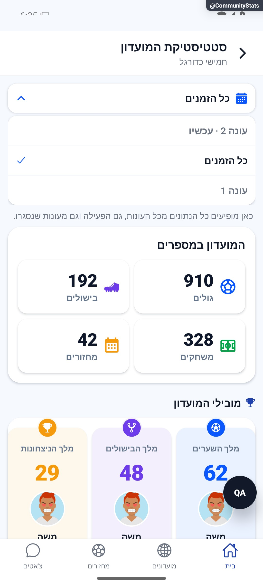

# טווחי סטטיסטיקה ומקורות הנתונים

קריאת מוביל שמתבטלת לאחר עזיבת המסך אינה מוסרת תוצאה חלקית לצפייה הבאה.

## תלות שעודכנה — 23.10.2026

חלון recordWindow הקיים משמש גם לקריאת היסטוריית המובילים. תוצאה ממועדון/חלון קודם אינה מתקבלת; כיסוי חלקי אינו מוכיח כרונולוגיה. [פירוט](club-leaders-and-table.md).

## תיעוד כשלים — 20.10.2026

נוספו תצפיות דיווח בנקודות הכשל של המקורות המשויכים לפיצ׳ר, במסגרת הרחבה רוחבית. נשמרו ערכי החזרה, הזריקות ותנאי הפעולה הקיימים; נוסף מקור קוד והקשר לדיווח. כיסוי תחבירי אינו הוכחת הרצה של כל מצב. השינוי מקומי וטרם הופץ; בדיקות המסירה, מגבלות מניעת הכפילויות והמסלולים שטרם חוברו מתועדים בדוח המשותף.

[דוח דיווח השגיאות והראיות](../../changes/2026-10-20-error-reporting-audit.md).

## אימות מול שרת אמיתי והגבלת המתנה — 20.10.2026

נפרסו באישור16 שירותי עונות ונבדקו140 קובצי מקור לכל שירות. במועדון הבדיקות עבר רצף הפעלה עם7 מחזורים, יעד שכבר הושג, חלון תיקונים מדויק, סגירה ידנית, שמונה תארים, ארכיון ופתיחת עונה2 עם0 מחזורים ויעד24. עברו50 השוואות נתונים; המצטיין8.36 ומלך הניצחונות78.57%. ברכיב הסטטיסטיקות נוסף `withSeasonReadTimeout`:30 שניות לתמונת מצב עקבית, רשימת עונות וארכיון/כל הזמנים כולל בדיקת עקביות בסוף. כשל מוביל לניסיון חוזר ואינו מספר אפס; תוצאה מאוחרת אינה מוחלת. התיקון המקומי בלקוח נבדק במסך עם קריאה מושהית והחלמה, וב־5,093 בדיקות ובדיקת טיפוסים. נוסחאות התארים לא שונו. הסגירה הטבעית אחרי24 שעות, כמה זכאים וכימיה של שני חשבונות אמיתיים לא הורצו בייצור.

[הבדיקה, המקור, הצילומים והמגבלות](../reviews/2026-10-20-seasons-live.md).

## תיקון פערי העונות — 20.10.2026

`seasonLock.ts` אוכפת פקיעה גם לפני הסריקה; השלמת עיבוד מחזור מותרת במפורש בלי לפתוח ארכיון חתום. שינוי יעד נבדק גם בעסקת `acquireSeasonOperation`. `seasonManager.needsVerification` משותפת לרשימה ולחסמי הסגירה; `setEveningPlayed` בודקת מועד, שיוך והרשאה מתוך נתונים עדכניים בעסקה. `src/utils/seasonReadConsistency.ts` וחותמת עונה מהחנות מונעות קריאה מעורבת ומרעננות לשונית שנשארה מותקנת. `seasonSummaryService.ts` בוחרת מונים חיים לעונה פעילה ואינה דורשת ארכיון חסר; משתתף שעזב ממשיך לקרוא ארכיון מורשה. אין שינוי בנוסחאות או בהרשאות.

עברו 5,090 בדיקות באפליקציה, 352 בדיקות הרשאות, 52 תרחישי מדיניות/גבולות/רצף, 38 תרחישי ארכיון ובדיקות טיפוסים והידור. שני תרחישי הרצף הורצו גם דרך שירותי הקריאה של האפליקציה ולקוח מזוהה מול הכללים המלאים. `functions/seasonAudit20261020.emulator.test.mjs` עובר כעת; נוספו `functions/seasonFullFlow.emulator.test.mjs`, `tests/logic/seasonReadConsistency.test.ts` ו־`tests/logic/communitySeasonRefresh.test.ts`. הפלטים ב־`artifacts/seasons-fixes-2026-10-20`. מסירת אירועי הענן מדומה; אין טענה לפריסה או לבדיקת שני מכשירים/אייפון.

[דוח תיקונים, בדיקות ומגבלות](../reviews/2026-10-20-seasons-fixes.md).

## בדיקת עונות חוזרת — 20.10.2026

בדיקה חוזרת מצאה ארבע תקלות משוחזרות: תיקונים והארכת יעד אחרי תום חלון התיקונים, סגירה למרות מחזור שממתין לאימות ללא מועד, ואישור מועד שאינו מתאים לשיוך העונה. נמצא בקוד גם פער ברענון לשונית סטטיסטיקות שנשארת פתוחה בזמן שינוי עונה. אלה ממצאים פתוחים; טרם תוקנו. מסלולי הליבה עברו את הבדיקות הקיימות, אך אין עדיין אישור תקינות מקצה לקצה.

[הממצאים, מה עבר וסדר התיקון המוצע](../reviews/2026-10-20-seasons-audit.md).

נוספו מבחני שחזור ב־`functions/seasonAudit20261020.emulator.test.mjs`: אחד עבר וארבעה נכשלו מול האפיון, בכוונה משאירים את הפערים גלויים. זו אינה תוצאת הצלחה של החבילה החדשה. הבדיקות הקיימות עברו: 444 חבילות/5,082 בדיקות באפליקציה, 42 תרחישי מדיניות במסד, 38 תרחישי ארכיון, 11 שילובים נוספים ו־352 בדיקות הרשאות טוריות. טיפוסים באפליקציה והידור השרת עברו. לא שונתה לוגיקת המוצר ולא בוצעה פריסה. הראיות והמגבלות ב־`artifacts/seasons-audit-2026-10-20` ובדוח המקושר; לא הורצה שרשרת לקוח–שרת–טריגרים מלאה ולא נבדקו שני מכשירים אמיתיים.

## עדכון מקומי — 10.10.2026

חוזה המקורות האישיים: כשל `getGamesByPlayer` או `pairStatsService.listGlobalForUser` בשירות `playerStatsService` נזרק לקורא במקום להפוך לנתון אפס. `StatisticsScreen` מציג כשל וניסיון חוזר ושומר תוצאה קודמת. זהו שינוי באמינות הקריאה, לא בנוסחאות או בטווחי העונה של `CommunityStatsScreen`; איחוד ארכיונים, מכני כיסוי וסיכום עונה לא שונו בסעיף זה. מבחן השירות מוודא ששאילתה שנכשלה אינה מחושבת כרשימת פעילות ריקה.

**מצב האימות:** תיקון מקומי, 10.10.2026. ראיות השירותים ופונקציות המקור ב־`tests/logic/clientAuditRecovery.test.ts`; הריצה הממוקדת המתועדת עברה 417 בדיקות ב־8 חבילות; השלמת שחזור מאוחר תועדה בדוח התיקון. [דוח התיקון והגבולות](../../../artifacts/pre-release-2026-10-10/client-fixes.md). לא הורצו כאן פעולות מול מסד אמיתי ולא צולמו מצבי כשל רשת חדשים; התמונות ההיסטוריות אינן הוכחה לתיקון זה.

[להסבר הקצר והפשוט](scopes-and-data.simple.md)

עודכן: 07.10.2026; מקור: `8e8fde5`. מסך ראשי: `src/screens/communities/CommunityStatsScreen.tsx`; רכיב בחירה: `src/components/stats/SeasonScopeBar.tsx`.

## שלושה חלונות

| חלון | מקור | משמעות |
|---|---|---|
| עונה נוכחית | מונים חיים לעונה | המספרים מאז תחילת העונה הנוכחית |
| עונה סגורה | ארכיון עם שחקנים/צמדים קפואים | אין השלמה מהמונים החיים כאשר הארכיון חסר |
| כל השנים | ארכיונים יחד עם החלון החי | דורש איחוד תקין; אין לשכפל עונה שכבר נסגרה |

כיבוי עונות אינו מוחק ארכיונים, וברירת המחדל במועדון ללא עונה פעילה היא כל השנים. בזמן איחוד ארכיונים צריך להמתין; מונה חי אינו ״כל השנים״. אם ארכיון נדרש אינו זמין, מוצגת אי־זמינות או חזרה לטווח בטוח בהתאם למסך, ולא טבלת אפסים בשם העונה הישנה.

הסגל הנוכחי אינו מספיק להסביר את כל ההיסטוריה. ארכיון שומר שמות המשתתפים, לרבות משתמש שהחשבון שלו הוסר. אורחים יכולים להופיע בנתונים בלי קישור לפרופיל. יש להבחין בין היעדר תמונה לבין היעדר אדם.

## כיסוי ואחוזים

`countedRounds` הוא מספר המשחקונים עם מידע שמאפשר את המדד, ואינו מספר כל המשחקונים. המכנה נשמר גם בכיסוי חלקי, אך הערת הכיסוי הוסרה מהממשק לפי החלטת הבעלים ב־28.9; אין מסגרת ״מתוך״ נוכחית. מדגם חסר אינו 0%. אחוז ניצחון מסוים עשוי להשתמש בניצחונות והפסדים בלבד ולהשמיט תיקו; אין להשתמש בנוסחה אחרת רק משום שהשם דומה. ספירת השתתפות במחזור נקבעת ב־`eveningPlayed.ts` ובמודלים הייעודיים, לא משערים שנרשמו.

## תלות ובדיקות

`src/utils/statsScope.ts`, `seasonScope.ts`, `seasonArchive.ts`, `seasonCoverage.ts`, `seasonParticipants.ts`, `efficiencyStats.ts`; `src/services/seasonHistoryService.ts`, `seasonSummaryService.ts`, `gameService.ts`; `src/firebase/firestore.ts`. בדיקות `seasonScope`, `seasonScopedStats`, `seasonArchivePairs`, `seasonArchiveTable`, `seasonCoverage`, `coverageBackCompat`, `seasonCounterReconciliation`, `groupSeasonsReader` ב־`tests/logic`.

## ראיות, היסטוריה והשלמות

צילומי הדמה מציגים בחירת עונה נוכחית. בחירת כל השנים, עונה סגורה, ארכיון חסר לא אומתו בצילום נוכחי. מדגם חלקי נראה בדמו: 120 משחקונים עם תוצאה מתוך 210 משחקונים במונה הראשי. מקור 051 מתאר הסתרת כימיה בארכיון — הוחלף. מקורות 078/079/091 מתארים מעבר למכנה מכוסה; טענת ״אי אפשר לשחזר היסטוריה״ הוחלפה בהמשך במקור 115 שמתאר שחזור. אין להפוך עצת מיגרציה היסטורית לפעולת ייצור חדשה.

## הצעות בלבד

להציג הגדרת טווח קצרה במקום להעמיס את אותם תאריכים בכל אזור; להראות מצב טעינה לשינוי טווח לפני מספרים; לשמור את סדר הכרטיסים והגבהים בזמן איחוד. לשינויי טווח לא להנפיש מספרי ביניים כאילו הם נתון סופי.

## פירוט טכני נוסף — זרימה, חישוב ונקודות שינוי

`StatsScope` הוא איחוד מובחן: `current`, `all`, או `season` עם מזהה; אין להשתמש במזהה עונה מדומה לציון כל השנים. `buildScopeOptions` מציג מצטבר רק כשקיימות עונות עבר, ו־`clubHasScopes` מונע בורר מיותר במועדון שלא הפעיל עונות.

המצטבר מחבר את המונים החיים ואת ארכיוני העונות ב־`mergeAllTime`, ואת הצמדים ב־`mergePairs`; הוא אינו מחשב מחדש משחקונים מתוך שערים. ארכיון חסר אינו אפס: במסלול ההשוואה הפער מחזיר `null`, וגם מועדון עם עונות ידועות ורשימת ארכיונים ריקה מסורב. מ־13.10.2026 `coverage` ב־`efficiencyStats` אינו משחזר כיסוי חסר מ־`rounds`; חסר או פגום נחשב לכיסוי לא ידוע. לכן שדה חדש דורש ממיר ותאימות לאחור; להוסיף סוג בלבד אינו מספיק. בדיקות `coverageBackCompat`, `seasonCoverage` ו־`seasonArchiveTable` מגנות על כך.

הפירוט מתאר את הקוד שנקרא, ולא בדיקת כתיבה או הרשאות בסביבת הייצור. יש לקרוא את הקוד הממוקד וההפרש מאז מקור המיפוי לפני תיקון; בדיקות המוזכרות כאן לא הורצו מחדש לצורך עריכת התיעוד.

## השלמת הנפשות — 8.10.2026

SeasonScopeBar פותחת את רשימת options ב־HeightReveal במשך 260 אלפיות שנייה; ChangeMotion מדגישה calendar כאשר title/titleOf משתנים. CommunityStatsScreen עוטפת את גוף המסך במעבר 220 לפי groupId, scope.k, season.id ו־scopeLoading. נשמר gap=spacing.sm שהיה על ScrollView, ואין הזזת שורות כתוצאה ממעטפת שאיבדה רווחים. אין פס בחירה נע: הבורר בפועל הוא רשימה נפתחת. loading/slice ומיזוג הארכיונים לא שונו; התנועה אינה מחשבת מספרי ביניים. הבורר והחלפת בחירה הורצו בדמו; נכונות מוני הארכיונים וכשל טעינה לא אומתו בסבב זה.

[פרטי האימות והמגבלות](../../changes/2026-10-08-motion-completion.md). מקור: `9ec0dfd` עם שינויים מקומיים; טרם פורסמה גרסה.

## דפדוף מלא ושמירת משמעות שדה חסר — 10.10.2026

`gameService.getCommunityStats` קוראת את כל המחזורים הסופיים בדפים בני 200. כל דף ממשיך באמצעות `startAfter` על צילום המסמך האחרון ובאותו מיון `startsAt desc`, כך שמחזורים בעלי זמן זהה אינם נשמטים. החישובים מתחילים רק לאחר קריאת כל הדפים; כשל בדף מאוחר אינו מחזיר מצטבר חלקי במסלול המחמיר. תחום העונה ממשיך לעבור דרך `inSeason`, ואילו `lifetime` כולל את כל הדפים. אין כאן שינוי במכנה ההשתתפות או במוני המשחקים הפנימיים.

`gameDocConverter` משתמש ב־`registeredUserIds`/`waitlistUserIds`/`pendingUserIds` רק כאשר השדה המודרני המתאים נעדר (`undefined`). מערך מודרני ריק הוא ביטול סמכותי; `null` או ערך פגום אינם הצדקה להחזיר שחקן משדה ישן. גם גזירת `participantIds` כשנעדר שומרת על אותו כלל. שדה `participantIds` קיים נשאר המקור שלו, ללא מיגרציה או כתיבה.

`releaseLogicFixes` מאמתת 401 מחזורים בשלושה דפים, 391 בעונה הנוכחית, רצף מצטבר 401, כשל בדף שני ושלוש צורות קריאה בממיר המקורי: חסר, ריק ו־null. זו הרצה מבודדת של המקור; לא נקרא או שונה מסד הייצור.

## תיקוני עונות — 11.10.2026

כשהעונות כבויות אין בחירה של ״עונה נוכחית״: היא הייתה מערבבת מחזורי חיים עם מונים שלאחר איפוס. ברירת המחדל היא כל הזמנים. `statsScope` מסננת `nonSeason` מבורר העונות. `CommunityStats`, `pairCompareService`, `PlayerCompareScreen` והמספרים בפרטי המועדון כוללים תקופות אלו בצבירה לכל הזמנים. רשימת העונות התחרותיות נבדקת מול `count`, ואז נבדקת שלמות כל הארכיונים; תקופת כיבוי אינה משלימה עונה חסרה. הצבירה היא מונים חיים + כל הארכיונים, לרבות תקופות הכיבוי, וכל רכיבי היחס משתמשים באותו תחום. `readSeasonArchiveData` מצרפת עמודי צמדים ומסרבת לתשובה חלקית. כשל בטעינת כל הזמנים אינו חוזר לנתוני ״נוכחית״ במועדון שעונותיו כבויות.

השינוי מקומי בלבד. [ראיות, בדיקות ומגבלות](../reviews/2026-10-11-seasons-fixes.md).

## גבולות מידע אישי — 11.10.2026

לאחר אישור הבעלים, קוראי זהות של שחקן אחר משתמשים בהיטל ציבורי בלבד; `users`, `playerStats` ותארים אישיים מוגבלים לבעלים. נתוני זוג אישיים מוגבלים לאחד המשתתפים; סטטיסטיקה מלאה של אדם אחר נשלחת דרך שער הפרטיות בשרת. טבלאות, תוצאות, השוואות וארכיוני מועדון נשארו לפי הרשאת המועדון. פרטי מסלול הקריאה, המקרים והבדיקות ב[גילוי שחקנים ופרטיות](../profile/player-discovery.md). השינוי מקומי וטרם נפרס; אין כאן אימות חדש של תצוגת ייצור.

## החלטות הבעלים — 13.10.2026

גם פעילות מתקופה לא תחרותית נשארת בכל הזמנים, אף אם עדיין לא הסתיימה עונה תחרותית. מידע חסר אינו נחשב לכיסוי מלא.

`hasArchivedStats` כולל `hasArchivedPeriods`. קוראי מועדון, השוואה ופרטי מועדון קוראים גם תקופות `nonSeason`; השוואה וצבירה מסרבות לסיכום חסר במקום להציג רק עונה נקייה. חלון שיאי העונה מוסתר עד טעינת גבול הארכיון, גם כאשר `count=0`. כיסוי חסר או פגום ב־`efficiencyStats` וב־`seasonPersonal` נחשב לא ידוע (אפס משחקים מכוסים), ללא שחזור משוער.

השינוי מקומי וטרם נפרס. [פירוט הבדיקות והמעבר](../../changes/2026-10-13-approved-statistics-policy.md).

## תלות בעדכון העונות — 19.10.2026

קוראי ההיסטוריה והסיכום מסננים publicationPending כדי לא להציג ארכיון חלקי. nonSeason נשארת חלק מהצבירה הקיימת ולא הופכת לעונה לבחירה. בסיכום פעיל אין מוביל זמני של תואר המצטיין. בסיכום סגור מוצגת סיבת אי־הענקת תואר כשאין זכאי או חסר תיעוד.

[מצב המימוש, הבדיקות ומגבלות האימות של העונות](../clubs/seasons.md). מקומי בלבד; לא בוצעה פריסה במסגרת המשימה.

## החזרת ניסיון מבוטל למאגר ללא עונה — 19.10.2026

`functions/src/seasonUnassigned.ts` מעבירה שורות של תקופות לא תחרותיות למונים החיים בעסקאות: הוספה ליעד והסרה מהמקור יחד. סכומי המועדון וכרטיס המקור מתרוקנים יחד; קבלות ריקות אינן מוסיפות דבר לקוראי הצבירה הקיימים. סכום ומספר ציוני המחזור עוברים ללא חישוב מחדש. מכנים חסרים וכיוון הצמד נשמרים. ארכיונים תחרותיים קפואים לא משתנים. נבדקו גם כשל אחרי העברת שורות וחידוש ללא כפילות.

[הכללים, הבדיקות ומגבלות האימות](../clubs/seasons.md). מימוש מקומי בלבד, ללא פריסה או שינוי נתוני מועדונים בייצור.

## הבהרת התצוגה וסיכום אישי — 19.10.2026

הרכיבים והמלל המשותפים של סיכום העונה עודכנו: ניסוח ברור לניצחונות ולהפסדים, אוואטרים למובילים וכפתור ״סיכום העונה שלי״ בעיצוב כרטיס. הספירות, מסנן העונה, התארים וכללי הזכאות לא השתנו. המסכים האחרים בתחום לא הורצו מחדש במסגרת תיקון התצוגה. [פירוט וראיות בסיכום העונה](../statistics/season-summary.md). השינוי מקומי וטרם הופץ.

## מלך הניצחונות לפי אחוז — 19.10.2026

״מלך הניצחונות״ בעונות החדשות נקבע לפי אחוז הניצחונות מתוך כל המשחקים שהשחקן שיחק בעונה, כולל תיקו במכנה. חובה להשתתף בלפחות מחצית ממחזורי העונה, בעיגול כלפי מעלה: 7 מתוך 13. האחוז מעוגל לשתי ספרות אחרי הנקודה; שוויון אחרי העיגול מזכה את כל השותפים. אין צורך בציון מחזור לצורך תואר זה. בלי זכאי עם נתונים תקפים ולפחות ניצחון אחד אין תואר, ובסיכום מוצגת הסיבה. יתר התארים המצטברים שומרים על הכללים הקיימים, ללא סף נוכחות. התארים שכבר נסגרו נשארים כפי שנקבעו. `computeTopWinner` משותף ללקוח ולהעתק השרת ב־`seasonAwards.ts`. שער הנוכחות משתמש ב־`games` מול `ceil(completedRounds / 2)`; האחוז משתמש ב־`wins / rounds * 100`, כאשר `rounds` הוא משחקים, לא מחזורים. המכנה חייב להיות חיובי וסופי; ניצחונות חייבים להיות חיוביים ולא לעבור את המכנה. אורחים אינם זכאים. אחוז חיובי שמתעגל ל־0.00 אינו מתפרש כאפס ניצחונות. בתוצאה החדשה `value` הוא 0–100 ו־`valueUnit: percent`; היעדר יחידה נשאר ספירה היסטורית, לרבות הערך 1. הסף אינו תלוי בציונים. נתיב השמירה כולל `functions/src/seasonRollover.ts`, `functions/src/seasonPublication.ts`, `seasonSummary.awards`, `seasonCards.winners` ותארי הפרופיל. `awardsVersion: 2` מתעד את כללי העונה גם כשלא הוענק תואר; `winnerIds` בכרטיס מונע התאמת זוכים לפי שם משותף. מסלול חידוש סגירה ופרסום חוזר משתמש במידע החתום. הקוראים ב־`seasonHistoryService`, `seasonSummaryService` ו־`seasonTitlesService` מעבירים את היחידה. כל מציגי התואר ותמונות השיתוף מעבירים אותה למפרמטים המשותפים; `medalTier` מדרג אחוז חדש אחרי חלוקה ב־100 ומשמר ספירות ישנות. בסטטיסטיקת העונה הפעילה משתמשים בחישוב המשותף; בעונה סגורה חדשה משתמשים בזוכים החתומים לפי מזהה. תצוגת כל הזמנים וסדר טבלת המועדון נשארו ללא שינוי. [פירוט וראיות בסיכום העונה](../statistics/season-summary.md). השינוי מקומי וטרם הופץ.

## אוואטרים לכל המובילים משמאל לטקסט — 20.10.2026

האוואטר מופיע כעת משמאל לכותרת ולשם בכל שורת תואר שיש בה מוביל. נתוני הדמה של כל התארים, הפעילים והסגורים, הושלמו עם מזהי השחקנים; קודם המזהים היו חסרים ברוב השורות ולכן הוצג אוואטר רק במלך הניצחונות. תואר ללא מוביל והמצטיין החסוי אינם מציגים אוואטר. ב־`SeasonAwardRows` סדר הילדים הוא טקסט, אוואטר, ערך, סמל תואר; תחת כיווניות הממשק האוואטר נמצא משמאל לטקסט. אין התאמת זהות לפי שם. דוגמת `mockSeasonSummary` כוללת `winners` עם מזהים לכל תואר. נבדקות העברת הזהויות גם בעונה פעילה וגם בסגורה, ומיקום האוואטר בסדר הרכיבים. [לפני — צילום שסיפק הבעלים](../screenshots/season-avatars-user-before-2026-10-20.png), [אחרי — מתאם דפדפן](../screenshots/season-avatars-left-after-2026-10-20.png). המקור הוא `artifacts/seasons-implementation-2026-10-19/preview-avatars-left.cjs`, עם רכיב המקור ואוואטרים מקוריים, סמלי תארים וגופן מותאמים ונתונים מנותקים. אין אימות חדש במכשיר. השינוי מקומי וטרם הופץ.

## אימות תצוגה מקורי אחרי התיקון — 20.10.2026

[סטטיסטיקות אחרי התיקון](../screenshots/seasons-integrity-statistics-after-2026-10-20.png) · [סיכום שנפתח מהכפתור](../screenshots/seasons-integrity-summary-after-2026-10-20.png). נבדקו באימולטור אנדרואיד מקורי במצב דמה כפוי: טעינה עד להצגת הנתונים, כיווניות ופתיחת הסיכום מכפתור הסטטיסטיקות. לא בוצעו סיום או כיבוי באימולטור. אימות שינוי עונה ורענון לשונית מותקנת נעשה בבדיקות הרכיב והמסד, ולא בשינוי נתוני מועדון במכשיר. מסך הסטטיסטיקות צולם כעת בנפרד, בעוד צילום הביקורת הקודם היה מוטמע בתוך המועדון; אין כאן השוואת פיקסלים של אותה מעטפת. נתוני הדמה אינם נתוני בדיקת הרצף המבודדת.

## תלות במידע על סגירת עונה — 23.10.2026

בדיקת ההבדל ב־`src/firebase/firestore.ts` וב־`src/types/index.ts` מראה שהשינוי מוגבל לקריאת `seasons.closureStatus` בחוזה `GroupSeasons`. יתר ממירי הנתונים והמסלולים המתועדים כאן לא שונו במשימה זו. אימות הריצה החדש מתייחס להתאוששות ולכרטיס העונה, ולא להרצה חדשה של כל מצבי המסך הזה. [המסלול, הבדיקות והמגבלות](../../changes/2026-10-23-season-automatic-recovery.md).

## אימות לחיצות באנדרואיד — 23.10.2026

התיקון הקיים ללחיצות לאחר גלילה נבדק מחדש באימולטור אנדרואיד 35 עם דמו: לשונית משחקים נעוצה במחזור ופתיחת כרטיס השיתוף במועדון פעלו בלחיצה הראשונה לאחר הגלילה. נשמר יומן אירועים; אין שינוי נוסף במנגנון ואין אימות במכשיר המדווח או באייפון. [ראיות וגבולות](../../changes/2026-10-23-crash-test-and-pulse-followup.md).

## דיווחים חדשים במהלך הסבב — 23.10.2026

`SeasonTitleAwarded.pairs` נבנה בתוך `allTitlesOf` ב־`src/services/seasonSummaryService.ts` ממפתחות הזוכים המקוריים, ולא מפענוח שמות. `SeasonAwardRows` ב־`src/components/summary/SeasonClubSummary.tsx` מציג קבוצה נפרדת לכל צמד ושומר שחקן שמופיע בכמה צמדים; רשומות ישנות ללא `pairs` מציגות את שמות הצמדים בקבוצות נפרדות. אין שינוי בזוכים או בחישובים. `ChemistrySection.emptyText` מקבל מלל סגור רק כאשר `model.closed`; קריאות חיות נשארות עם המלל הקיים. `src/screens/profile/SeasonSummaryScreen.tsx` בוחר את ההסבר לפי `tab`, בלי לשנות את ההסבר האישי. נבדקו קורא ארכיון, שמות זהים ושחקן משותף לכמה צמדים, והמסכים נצפו באנדרואיד בדמו. [ראיות ומגבלות](../../changes/2026-10-23-crash-test-and-pulse-followup.md).

## עדכון תלות משותפת בקריאות מידע — 23.10.2026

בקובצי השירות המשותפים נוספה אפשרות מפורשת לניסיון חוזר אחד בקריאה זמנית שנכשלה, תוך עצירה אם החשבון מתחלף. החיבור מוגבל ל־14 נקודות קריאה המפורטות בדוח; אין כאן טענה שכל פעולה בפיצ׳ר קיבלה ניסיון חוזר או שנבדק מסך חדש. בדיקות המאגר המלאות עברו (5,261 בדיקות ב־472 חבילות), אך אינן הוכחת הרצה במכשיר. הקוד מקומי וטרם הופץ. [מסלול, ראיות ומגבלות](../../changes/2026-10-23-four-open-errors.md).
