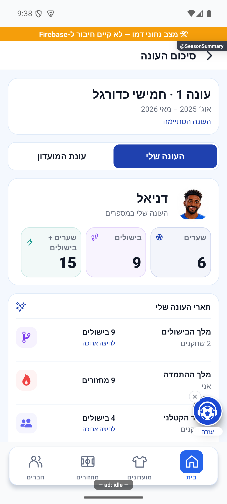
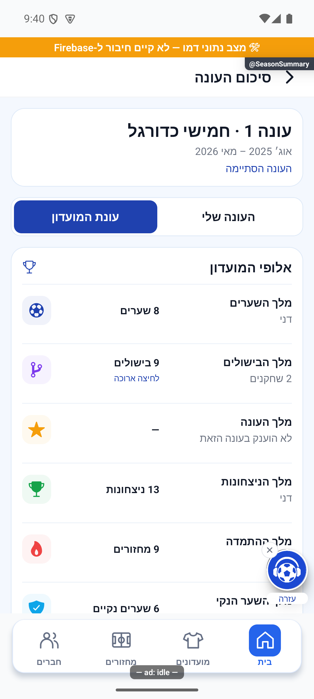
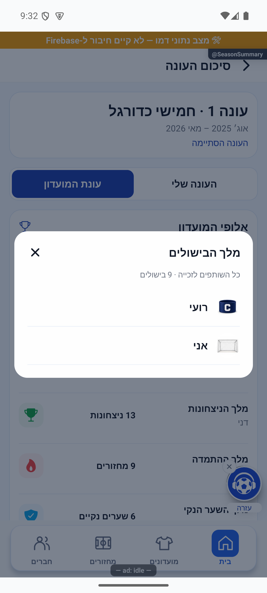
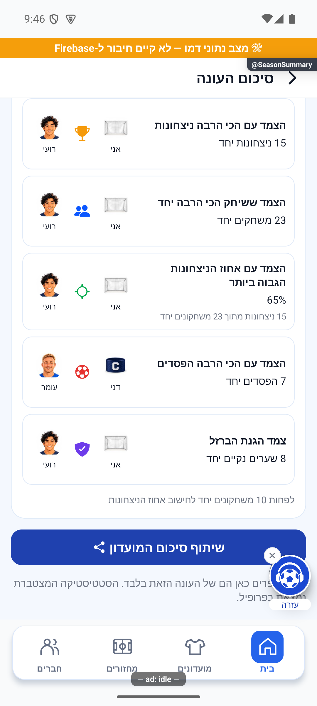
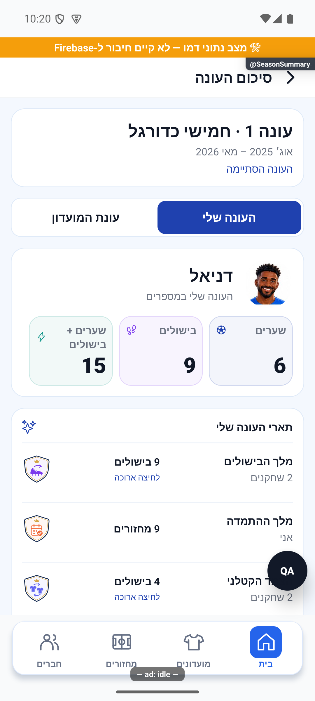
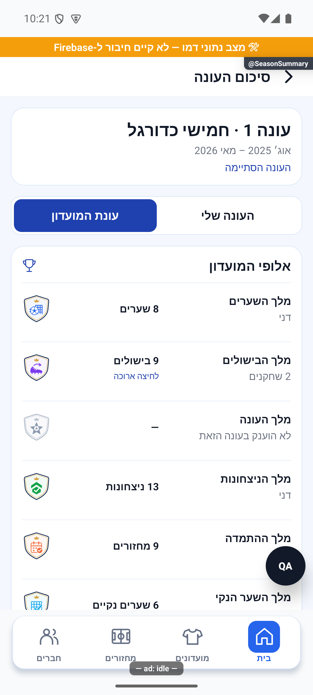
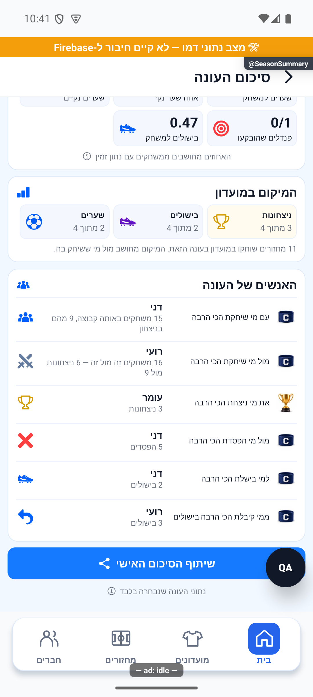
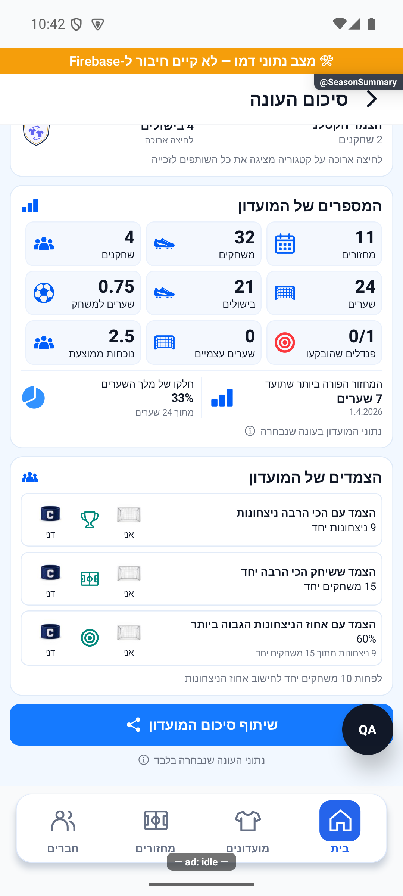
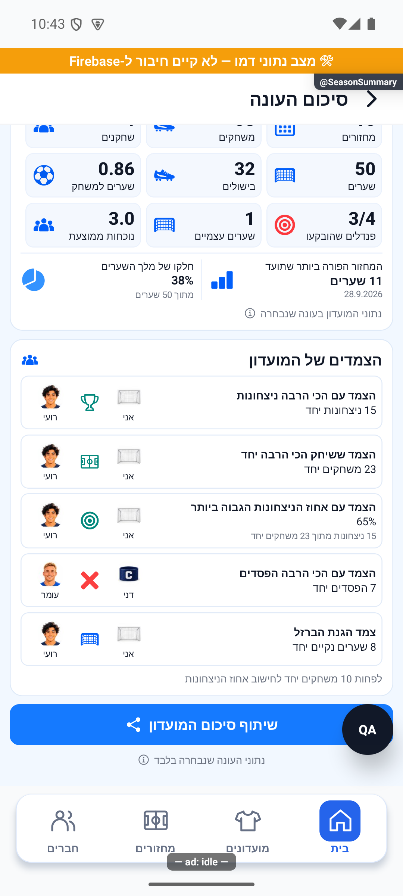

# סיכום עונה אישי ושל המועדון

## תלות משותפת בכפתור בדיקת הקריסה — 23.10.2026

נבדק ההפרש הממוקד ב־`src/screens/tabs/ProfileScreen.tsx` וב־`src/i18n/he.ts`: נוסף כרטיס בדיקת קריסה ומלל הבדיקה בלבד. אין שינוי מכוון בניווט, במספרים או בתנאי הפעולה של הפיצ׳ר המתואר כאן. אין אימות מכשיר חדש של המסלול הזה. [פירוט האימות והמגבלות](../../changes/2026-10-23-crash-test-and-pulse-followup.md).

קריאת מוביל שמתבטלת לאחר עזיבת המסך אינה מוסרת תוצאה חלקית לצפייה הבאה.

## תלות שעודכנה — 23.10.2026

בחירת נציג תצוגה ב־CommunityStatsScreen אינה כותבת מחדש את seasonCards, seasonArchives או תארי המשתמשים. [חוזה הנציג וההיסטוריה](club-leaders-and-table.md).

## תיעוד כשלים — 20.10.2026

נוספו תצפיות דיווח בנקודות הכשל של המקורות המשויכים לפיצ׳ר, במסגרת הרחבה רוחבית. נשמרו ערכי החזרה, הזריקות ותנאי הפעולה הקיימים; נוסף מקור קוד והקשר לדיווח. כיסוי תחבירי אינו הוכחת הרצה של כל מצב. השינוי מקומי וטרם הופץ; בדיקות המסירה, מגבלות מניעת הכפילויות והמסלולים שטרם חוברו מתועדים בדוח המשותף.

[דוח דיווח השגיאות והראיות](../../changes/2026-10-20-error-reporting-audit.md).

## אימות מול שרת אמיתי והגבלת המתנה — 20.10.2026

נפרסו באישור16 שירותי עונות ונבדקו140 קובצי מקור לכל שירות. במועדון הבדיקות עבר רצף הפעלה עם7 מחזורים, יעד שכבר הושג, חלון תיקונים מדויק, סגירה ידנית, שמונה תארים, ארכיון ופתיחת עונה2 עם0 מחזורים ויעד24. עברו50 השוואות נתונים; המצטיין8.36 ומלך הניצחונות78.57%. ברכיב הסטטיסטיקות נוסף `withSeasonReadTimeout`:30 שניות לתמונת מצב עקבית, רשימת עונות וארכיון/כל הזמנים כולל בדיקת עקביות בסוף. כשל מוביל לניסיון חוזר ואינו מספר אפס; תוצאה מאוחרת אינה מוחלת. התיקון המקומי בלקוח נבדק במסך עם קריאה מושהית והחלמה, וב־5,093 בדיקות ובדיקת טיפוסים. נוסחאות התארים לא שונו. הסגירה הטבעית אחרי24 שעות, כמה זכאים וכימיה של שני חשבונות אמיתיים לא הורצו בייצור.

[הבדיקה, המקור, הצילומים והמגבלות](../reviews/2026-10-20-seasons-live.md).

## תיקון פערי העונות — 20.10.2026

`seasonLock.ts` אוכפת פקיעה גם לפני הסריקה; השלמת עיבוד מחזור מותרת במפורש בלי לפתוח ארכיון חתום. שינוי יעד נבדק גם בעסקת `acquireSeasonOperation`. `seasonManager.needsVerification` משותפת לרשימה ולחסמי הסגירה; `setEveningPlayed` בודקת מועד, שיוך והרשאה מתוך נתונים עדכניים בעסקה. `src/utils/seasonReadConsistency.ts` וחותמת עונה מהחנות מונעות קריאה מעורבת ומרעננות לשונית שנשארה מותקנת. `seasonSummaryService.ts` בוחרת מונים חיים לעונה פעילה ואינה דורשת ארכיון חסר; משתתף שעזב ממשיך לקרוא ארכיון מורשה. אין שינוי בנוסחאות או בהרשאות.

עברו 5,090 בדיקות באפליקציה, 352 בדיקות הרשאות, 52 תרחישי מדיניות/גבולות/רצף, 38 תרחישי ארכיון ובדיקות טיפוסים והידור. שני תרחישי הרצף הורצו גם דרך שירותי הקריאה של האפליקציה ולקוח מזוהה מול הכללים המלאים. `functions/seasonAudit20261020.emulator.test.mjs` עובר כעת; נוספו `functions/seasonFullFlow.emulator.test.mjs`, `tests/logic/seasonReadConsistency.test.ts` ו־`tests/logic/communitySeasonRefresh.test.ts`. הפלטים ב־`artifacts/seasons-fixes-2026-10-20`. מסירת אירועי הענן מדומה; אין טענה לפריסה או לבדיקת שני מכשירים/אייפון.

[דוח תיקונים, בדיקות ומגבלות](../reviews/2026-10-20-seasons-fixes.md).

[להסבר הקצר](season-summary.simple.md)

עודכן: 18.10.2026. מקור בסיס: `5148f63c2a8e9c454b68132fdb0d683a98a4adc9`, בתוספת שינויים מקומיים. המסך: `src/screens/profile/SeasonSummaryScreen.tsx`. נקודת הכניסה: `src/screens/communities/CommunityStatsScreen.tsx`. המימוש במסלול הקיים `SeasonSummary` וברכיבים `SeasonSummaryScreen`, `SeasonClubSummary`, `SeasonClubShareCard`, `SeasonShareCard`. לא נוסף מסך ניווט ולא הופץ עדכון.

## כניסה והקשר

מסך סטטיסטיקת המועדון מעביר `groupId` ואת מזהה העונה שנבחרה, גם בעונה הפעילה וגם בסגורה. בבחירת כל הזמנים אין כפתור סיכום עונה. בתוך הסיכום אין בורר עונות: שתי הלשוניות, ״העונה שלי״ ו״עונת המועדון״, חולקות אותו מודל ואותה עונה. כניסות קיימות שאינן מעבירות `seasonId` ממשיכות לפתוח את העונה הפעילה. המסלול רשום בשלוש המחסניות הקיימות: מועדונים, מחזורים ופרופיל.

הכותרת מציגה שם מועדון, מספר עונה וטווח תאריכים. עונה פעילה המוגדרת במחזורים מציגה התקדמות במחזורים במקום טווח חודשי. תאריך התחלה שאינו ידוע אינו מוחלף בתאריך מומצא.

## הלשונית האישית

כרטיס זהות עם תמונת המשתמש ושלושת נתוני התרומה: שערים, בישולים וסכומם. אחריו התארים שהמשתמש זכה בהם, המספרים האישיים, המיקום במועדון וששת הקשרים האישיים. האייקונים סמנטיים וצבעוניים; אין מדליות מקום ראשון, שני או שלישי. המיקום נשאר מספר אמיתי, למשל ״2 מתוך 7״, עם אייקון של סוג הנתון.

`buildPersonalSeason` נשאר מקור החישוב האישי: מחזורים הם `games`, משחקונים הם `rounds`; אחוז ניצחון הוא ניצחונות חלקי משחקונים; שערים למשחקון משתמשים במספר המשחקונים. שיעורי שער נקי ובישולים משתמשים במכני הכיסוי `csRounds` ו־`asRounds` כשהם קיימים, ובמכנה המשחקונים לתאימות ישנה. הערת הכיסוי החלקי נשמרת בחלונית מידע, לצד הסבר קצר מתחת לאריחים. פנדלים מוצגים כהבקעות מתוך ניסיונות ועצירות מתוך בעיטות שנבעטו מול השחקן; שערים עצמיים מוצגים כשיש כאלה. אריחים מותנים משתלבים באותה רשת.

ששת הקשרים: השותף ששיחק איתי הכי הרבה, היריב שפגשתי הכי הרבה, את מי ניצחתי הכי הרבה, מול מי הפסדתי הכי הרבה, למי בישלתי וממי קיבלתי בישולים. אותם מוני צמדים ואותה עונה ממשיכים להזין אותם. אדם בלי פעילות מקבל הסבר בלשונית האישית ועדיין יכול לפתוח את נתוני המועדון.

## עונת המועדון

1. אלופי המועדון מופיעים ראשונים. תשע קטגוריות לפי `SEASON_TITLE_KEYS`, בשורות רחבות עם `SeasonTitleEmblem` משותף וצבעים קבועים דרך `seasonTitleTint`. קטגוריה שלא הוענקה מציינת זאת. בעונה פעילה הכותרת היא ״מובילי המועדון״ וההסבר מבהיר שהתארים טרם הוכרעו.
2. המספרים של המועדון מרוכזים בכרטיס אחד: מחזורים, משחקונים, משתתפים, שערים, בישולים, ממוצע שערים למשחקון, הבקעות וניסיונות פנדלים, עצירות פנדלים, שערים עצמיים, נוכחות ממוצעת וחלקו של מלך השערים. באותו כרטיס מוצג המחזור הפורה ביותר שתועד בטווח העונה, עם תאריך.
3. הצמדים של המועדון משתמשים ב־`ChemistrySection` במראה `summary`, ב־`pickChemistry` ובחמש הקטגוריות של מסך הסטטיסטיקה: `winningDuo`, `regulars`, `bestRatio`, `mostLosses`, `wall`. קטגוריה ללא מדגם מספק אינה מוצגת. לחיצה פותחת את `PairCard` עם אותם נתונים, ולא מבצעת קריאה חיה חלופית.

### שוויון בזכייה

`allTitlesOf` שומר את שמות הצמדים לצד רשימת `winners` של זהויות ייחודיות. `distinctSeasonWinners` מפרק מזהי צמדים ומסיר כפילויות לפי מזהה, ולא לפי שם. שני שחקנים בעלי אותו שם אינם מתאחדים. קטגוריה עם כמה שחקנים מציגה את מספרם; לחיצה ארוכה פותחת חלון עם כל השמות. בצמד מוצגים גם שמות הצמדים הזוכים. החלון נסגר בכפתור או בחזרה של המכשיר. גם התארים האישיים מאפשרים לראות שותפים לזכייה.

### מספרים ומכנים

`buildSeasonClubNumbers` קורא משחקונים פעם אחת מ־`totals.rounds` בארכיון או מ־`communityStats.rounds` בעונה פעילה. אסור לסכם את `rounds` של השחקנים למספר משחקוני המועדון. מספר המחזורים נלקח מ־`completedRounds` בארכיון ומ־`seasons.playedRounds` בעונה פעילה.

שערי המועדון ושערים עצמיים נקראים מסיכום המועדון. בישולים נלקחים מהסיכום כשהוא קיים, אחרת משורות השחקנים. מספר המשתתפים סופר שורות עם הופעה או משחקון. הנוכחות הממוצעת היא סכום `games` של השחקנים חלקי מחזורי המועדון. שיעור מלך השערים הוא מספר שערי המוביל חלקי שערי המועדון, כולל שערים שאינם מיוחסים לשחקן רשום במכנה. שערים למשחקון מחושבים רק כשיש מכנה חיובי. פנדלים נסכמים משורות השחקנים. מונה שחסר בכל המקורות הרלוונטיים נשאר `null` ומוצג כקו מפריד; אפס שנשמר במפורש נשאר אפס.

`seasonChemistryPairs` מייצר מפת `PairTotals` עם מפתח מסודר ומחליף גם את המונים הכיווניים כשסדר `a/b` הפוך. ספי הצמדים משותפים לסטטיסטיקה: 5 ניצחונות לצמד המנצח, 5 הפסדים לקטגוריית ההפסדים ו־5 שערים נקיים להגנת הברזל; למתמידים נדרשים 10 משחקונים יחד וליחס הניצחונות מדגם של 10 משחקונים ואחוז של לפחות 50%. שומר גם את החרגות החפיפה הקיימות: צמד ההפסדים אינו הצמד המנצח, וצמד הגנת הברזל אינו צמד ההפסדים. היחס הוא ניצחונות יחד חלקי משחקונים יחד, כולל תיקו במכנה.

המחזור הפורה נקרא באמצעות `roundSummaryService.listEveningStats` ו־`eveningRecordsOf`, מהתחלת העונה עד סיומה. התחלה חסרה אינה הופכת לטווח כל הזמנים. רק סיכומים עם היסטוריית משחקונים ומספר שערים חיובי משתתפים. אין הבטחה לכיסוי כל המחזורים ההיסטוריים. קריאה שמגיעה למגבלת 400 מסומנת במפורש; היעדר תיעוד או כשל אינם מוצגים כאפס. מנגנון הקריאה הקיים מסתיר כשל כשאין רשומות, ולכן אין כאן הבחנה חזותית בין היעדר תיעוד לכשל של רשומות המחזור בלבד. בדמו מסופק שיא סינתטי המתאים למודל העונה, בלי לערב דמו אחר.

## מסלול הנתונים ומצבים

| מצב | מקור והתנהגות |
|---|---|
| טעינה | מחוון; תגובה ישנה אינה מחליפה מסלול או רענון חדשים |
| עונה סגורה | `seasonSummary/{groupId}__{seasonId}` וכל `pairPages` דרך `readSeasonArchiveData`; תארים ושמות קפואים |
| ארכיון חסר | `null`; לא מוצגת עונה אחרת במקומו |
| כשל קריאה או עמוד חסר | מצב כשל ורענון, ללא מספרים חלקיים |
| עונה פעילה | קבוצת העונות, כל שורות השחקנים, כל צמדי המועדון וסיכום המועדון; זהויות ציבוריות באצווה דרך `groupService.hydrateUsers` |
| מובילים פעילים | `computeSeasonAwards`, באותם חוקים של הסגירה, אך בנפרד מ־`myTitles` ו־`seasonTitles` שנשארים ריקים |
| משתתף לשעבר | המודל הסגור עובד מהארכיון בלי קריאת זהויות חיות; רשומות מחזור נוספות עשויות לא להיות נגישות |
| צמדים ישנים בפורמט מספרי | אינם מוצגים כאילו הכילו פירוט מלא; `pairsComplete=false` מציג הודעת אי־זמינות |
| שוויון או שמות זהים | כל המזהים נשמרים; אין שבירת שוויון או איחוד שמות |
| נתון חסר או מכנה אפס | קו מפריד בשיעורים ובמונים שלא תועדו |

`ChemistrySection.identities` מאפשר להעביר זהויות של העונה במפורש. כשהוא ניתן אין השלמת שמות חיים. `pairs` מועבר תמיד במפורש בסיכום, כולל מפה ריקה; היעדר נתוני עבר אינו מפעיל את מסלול ברירת המחדל שטוען צמדים חיים.

שמות וצילומים חיים משתמשים בהיטל הציבורי הקיים; לא השתנו הרשאות, סכמות שרת, תארים חתומים או מונים שמאופסים בסגירה. כללי המצטיין וכיסוי הציונים נשמרו: ממוצע מעל 6, נוכחות לפחות בחצי ממחזורי העונה, וכיסוי אישי מתוך `coverageByWinner` כשקיים. שמונת התארים האחרים אינם מקבלים את סף הנוכחות של המצטיין. תארי הפנדלים נקבעים לפי מונים, וצמד בישולים לפי סכום הבישולים הכיווניים ולפחות 3. ארכיונים קיימים לא נכתבו מחדש. [תיקוני העונות הקודמים](../reviews/2026-10-11-seasons-fixes.md) ו[כללי הנתונים שאושרו](../../changes/2026-10-13-approved-statistics-policy.md).

## כיווניות ושיתוף

כל הטקסט וכותרות המידע מיושרים באמצעות `RTL_LABEL_ALIGN`. אין `row-reverse` או שילוב של `writingDirection: rtl` עם אותו יישור. תמונת השחקן מימין; אייקון בשורת מידע משמאל לתוכן. הלשונית האישית מימין, לשונית המועדון משמאל. כותרת הניווט היא הרכיב הקיים של האפליקציה.

כל לשונית מציגה כפתור שיתוף ושומרת כרטיס נפרד מחוץ למסך ברוחב 340: `SeasonShareCard` האישי או `SeasonClubShareCard` הקבוצתי. הכרטיס האישי אינו מכיל את מספרי כל המועדון, והקבוצתי אינו משתמש במספרים האישיים. כרטיסי שיתוף הם תמצית, ואינם העתק של כל המסך: כרטיס המועדון כולל זוכים ומספרים, ללא חמש שורות הצמדים או שיא המחזור. לכידה באמצעות `captureRef`, זמינות `expo-sharing` ושגיאת שיתוף נשמרו; אירוע השיתוף מקבל גם `tab`. לכידת שתי התמונות נבדקה מקומית בלי לפתוח שליחה חיצונית. בכרטיס החדש כותרות ומספרים קבועים בגודלם כדי לא לחרוג ברוחב הקבוע כשגודל הגופן במכשיר מוגדל.

## בדיקות וראיות

בדיקות `seasonClubSummary` מכסות ספירה יחידה של משחקונים, מכנים, חסר לעומת אפס, זהויות ייחודיות ונרמול צמדים. `seasonSummaryClubLoading` מפעילה את שירות הסיכום עם מקורות מדומים ובודקת ארכיון קפוא, צמדים שאינם כוללים את הצופה, נתוני מועדון ומובילים זמניים. `seasonSummaryAwards` בודקת תשע קטגוריות, פתיחה בלחיצה ארוכה ורשימת חמישה שחקנים בעלי אותו שם. `chemistrySectionLoading` מכסה היעדר גיבוי חי וזהויות היסטוריות. נשמרו בדיקות העונות, הכיסוי וההרשאות הקיימות.

צילום חמש קטגוריות הצמדים בעונה הפעילה כולל תוספת מקומית זמנית לזיכרון הדמו: `u_dani__u_omer`, עם 12 משחקונים, 4 ניצחונות ו־7 הפסדים. התוספת נועדה לכסות את קטגוריית ההפסדים שאינה מגיעה לסף בדמו הרגיל, לא נכתבה למסד ולא הוכנסה למונים אמיתיים. בחישוב נשמרה החרגת הצמד המנצח.

הצילומים הבאים הם מהמסך המרונדר באמולטור פיתוח מנותק עם נתוני דמה. אין בהם נתוני המועדון האמיתי או ראיה לגרסת חנות. מקור, חותמות ומגבלות ב־[מניפסט](../screenshots/manifest.json). בדיקת מסד ייצור, שליחה חיצונית, מצבי רשת אמיתיים וגופן מערכת מוגדל לא בוצעו במשימה הזאת.

תוצאות ההרצות האחרונות וגבולות ההפצה ב־[יומן השינוי](../../changes/2026-10-18-season-summary-tabs.md).

## סמלי אליפות משותפים — 18.10.2026

אושרה החלופה `artifacts/design-sketches/2026-10-18-title-symbols/07-championship-shield-crests-v1.png`. המימוש הוא רכיב וקטורי מקומי `src/components/SeasonTitleEmblem.tsx`, ולא תמונות שנחתכו מלוח הסקיצות. המגן בעל מסגרת כחולה, קו זהב עדין וכתר קטן. לכל אחד מתשעת המפתחות ציור מרכזי שונה: כדור ורשת, נעל וחץ מסירה, כוכב וכדור, סימן ניצחון, לוח שנה, רשת וסימון הצלחה, מטרה וכדור, כפפת שוער וכדור, ושתי חולצות עם חצי מסירה. צבע השערים הוא כחול קבוע וצבע ההתמדה כתום; שאר צבעי המשפחה נשמרו.

`SeasonAwardRows` משמש גם תארים אישיים וגם אלופי המועדון, ומשלב את אותו מגן בגודל 32 ובצד שמאל. גובה השורה המינימלי הוא כעת 44; הסמל הפנימי מוקטן ומוזז בתוך המגן כדי לא לגעת במסגרת. לקטגוריה שלא הוענקה מועבר `muted`, שמחליף את צבעי המגן והציור באפור; ההסבר שאין זוכים נשמר. שמות התארים עדיין נקראים מ־`he.seasonTitleNames`, והכפתורים, הזוכים והספים לא השתנו.

`SeasonShareCard` ו־`SeasonClubShareCard` משתמשים בדיוק באותו רכיב בגודל 30. לא נוספה תמונת רשת, טעינת גופן או בקשת שרת לצורך הסמל. העיטור דקורטיבי כשמופיע לצדו טקסט; תווית נגישות אופציונלית זמינה לשימוש עצמאי. אין הקצאת דרגת זהב/כסף/ארד לפי מספרי הזכייה.

תועדו צילומים מרונדרים מהדמו של שתי הלשוניות, מצב ללא זכייה ותמונות השיתוף. לא נבדקו כאן רשת אמת, גרסת חנות, הגדלת גופן מערכת או מצב כהה במכשיר. [היקף השינוי והאימות](../../changes/2026-10-18-season-title-emblems.md).

## התאמת הפריסה לסקיצות — 18.10.2026

סבב זה מחליף את המידות והפריסה מהצילומים הקודמים, בעקבות השוואה לשתי תמונות הסקיצה שהעלה המשתמש. מגני התארים שאושרו נשמרים; שאר האייקונים הם תמונות מקומיות שקופות דרך `SeasonSummaryIcon`, עם חלופות גופן לחרבות ולאייקונים שאינם במאגר. נעל למשחקים ולבישולים, רשת לשערים, כדור לשיעור שערים, מטרה לפנדלים, מגן לשיעור שער נקי ואייקון מובחן לכל נתון. מקור התמונות והנחיית יצירתן: `assets/season-summary/README.md`. אלה סמלים שנוצרו בעקבות הסקיצה, לא חיתוך מדויק שלה.

| רכיב | המראה הנוכחי ביחידות פריסה |
|---|---|
| מעטפת | שוליים 10, מרווח בין כרטיסים 8, רדיוס 13 וריפוד 10 |
| כותרת מועדון ועונה | ממורכזת, עיטור מגרש עדין מימין ותג סיום קטן; ללא בורר עונות |
| נתוני תרומה | שלושה אריחים אופקיים בגובה מינימלי 47, מספר ותווית מימין וסמל משמאל |
| נתונים אישיים וכלליים | שלוש עמודות, רוחב 32%, גובה מינימלי 45, מספר 18 ותווית 10 |
| תארים | מינימום 44 לשורה ומגן 32; רשימת השורות עטופה בנפרד כדי שמרווח הכרטיס לא יצטבר ביניהן |
| מיקום אישי | תווית מעל הדירוג, גביע זהוב לניצחונות, נעל סגולה לבישולים וכדור לשערים |
| אנשים אישיים | תמונה 29 מימין, תיאור קצר, שם ופירוט, ואייקון 23 משמאל |
| צמדים | גובה מינימלי 55, תמונות 28 ואייקון 21; שורה יכולה לגדול בטקסט ארוך |

הסדר האישי תואם את הסקיצה: ניצחונות–משחקים–מחזורים, אחוז ניצחון–תיקו–הפסדים, שיעור שערים–אחוז שער נקי–שערים נקיים. נתונים מותנים נשארים ברשת. התארים האישיים מציגים את ערך הזכייה מתחת לשם התואר; זכייה משותפת מסומנת ולחיצה ארוכה ממשיכה לפתוח את כל הזוכים.

מספרי המועדון מוצגים בתשע משבצות. מתחתיהן מופיעים בשורה אחת המחזור הפורה שתועד מימין וחלקו של מלך השערים משמאל. עצירות פנדלים מוצגות כשקיים נתון, בשורת טקסט באותו כרטיס; נתון חסר אינו הופך לאפס. תמונת השיתוף המועדונית עדיין כוללת את חלק מלך השערים ואת העצירות המתועדות. לא השתנו נוסחאות, מכנים, מקורות, ספים או בחירת עונה. ההסברים הארוכים נשמרים ב־`InfoTip` במקום להגביה את הכרטיסים.

נבדקו שני קצות הגלילה בשתי הלשוניות, שתי תמונות השיתוף וחמש קטגוריות הצמדים במראה החדש. נתוני הדוגמה שונים מנתוני הסקיצות בכוונה: למשל בעונה הסגורה 11 מחזורים, 32 משחקים ו־24 שערים; בעונה הפעילה 15 מחזורים, 58 משחקים ו־50 שערים. צילום חמשת הצמדים משתמש באותה תוספת זיכרון מקומית המתוארת לעיל, ללא כתיבה למסד.

צילומי מסך מקוריים, לא הדמיות ולא חיבור של גלילה. נבדק באנדרואיד בנתוני דמה מנותקים; לא בוצעה בדיקת אייפון, מצב כהה, גופן מוגדל, נתוני ייצור או שליחה חיצונית. [יומן השינוי והבדיקות](../../changes/2026-10-18-season-summary-sketch-fidelity.md).

## תארים ופרסום בעונות החדשות — 19.10.2026

`src/components/summary/SeasonClubSummary.tsx` מציגה `awardNotes` בסיכום סגור בלבד: אין זכאי למצטיין, אין ציונים תקפים או חסר תיעוד לחישוב תואר. `src/services/seasonSummaryService.ts` אינה שולחת מוביל זמני של המצטיין בעונה פעילה ואינה מחזירה ארכיון עם `publicationPending`. שאר נתוני העונה והסטטיסטיקות ממשיכים להופיע במהלך העונה.

ב־`src/utils/seasonAwards.ts` וב־`functions/src/seasonAwards.ts` הזכאות למצטיין היא נוכחות ב־`ceil(completedRounds/2)`; ממוצע של ציוני מחזור תקפים בלבד, עם עיגול לשתי ספרות לפני השוואה ושוויון משותף. `ratedRounds` מבדיל ציון אמיתי 6.0 משדה היסטורי ללא ציון. תארים מצטברים ללא שער נוכחות דורשים ערך חיובי; לצמד מספיק בישול הדדי אחד כמוביל. מכנה העונה מקורו במספר המחזורים הכולל, ולא במרב נוכחותו של שחקן.

`functions/src/seasonPublication.ts` מפרסמת מסמכי זכייה קבועים רק אחרי הארכוב, איפוס העונה ומעבר מצב המועדון. ניסיון חוזר משלים פרסום שנקטע בלי תואר כפול. אין פתיחת עונה סגורה מחדש. עברו 5,062 בדיקות אפליקציה ותרחישי המסד המפורטים ב[דוח העבודה](../../changes/2026-10-19-seasons-implementation.md); אין צילום חדש של מסך סיכום העונה באנדרואיד ואין פריסה. [מדיניות העונות והחזרת ניסיונות שבוטלו](../clubs/seasons.md).

## השלמת תצוגת ציוני המצטיין — 19.10.2026

`src/utils/seasonCoverage.ts` שומרת גם מדגם מלא, ואינה מסתירה 10 מתוך 10. `src/services/seasonSummaryService.ts` נושאת לכל זוכה את `coverageByWinner` האישי. `src/components/summary/SeasonClubSummary.tsx` מציגה את המדגם המשותף כשזהה, וכשהמדגמים שונים מפנה בלחיצה ארוכה לפרט של כל שחקן. בעונה פעילה, שם וציון מצטיין מסוננים גם ברכיב התצוגה; התווית החזותית ותווית הנגישות אומרות שיתגלה בסיום. אין שימוש בציון משחקון.

בדיקות `tests/logic/seasonSummaryAwards.test.tsx`, `tests/logic/seasonCoverage.test.ts`, `tests/logic/mvpCoverageWinners.test.ts` ו־`tests/logic/seasonAwardsMirror.test.ts` עברו: 31 בדיקות. [הסתרת המצטיין](../screenshots/seasons-mvp-hidden-after-2026-10-19.png) ו[מדגם לכל זוכה](../screenshots/seasons-mvp-samples-after-2026-10-19.png) נצפו בתצוגת רכיב המקור דרך מתאם דפדפן מנותק. אלו צילומי אחרי בלבד; סמלים ותמונות שחקן מותאמים לבדיקה, והלחיצה הארוכה מוחלפת באירוע מתאם. אין הוכחת רינדור או מחוות במכשיר. פירוט הבדיקות המלאות ב[דוח העבודה](../../changes/2026-10-19-seasons-implementation.md).

האימות הכולל האחרון: 443 חבילות ו־5,065 בדיקות אפליקציה, 90 בדיקות מסד, טיפוסים נקיים ובדיקת ניקיון הפרשים. תצוגת הדפדפן אינה אימות במכשיר; הבהרת הבעלים הושלמה: ניסיון קצר חוזר למאגר ללא עונה ונכלל בהפעלה הבאה.

עדכון מאגר המחזורים שומר שמות קפואים גם כשהרישום החי או חשבון השחקן חסרים. קבלות של תקופות לא תחרותיות שומרות שמות ומונים אפסיים אחרי ההעברה, כך שכל הזמנים נשאר מדויק. סגירה חדשה משתמשת בשם החי כאשר קיים ובשם המועבר כגיבוי.

## שם המצטיין וסדר התארים — 19.10.2026

תואר המצטיין נקרא כעת ״השחקן המצטיין״ ומופיע ראשון ברשימת התארים. יתר התארים שומרים על סדרם. השם משותף לכל המקומות המציגים את התואר; כללי הזכייה והסתרתו לפני הסיום נשמרו. הסדר מוגדר ב־`SEASON_TITLE_KEYS` בלקוח ובהעתק השרת; השם מוגדר ב־`TITLE.mvp` ב־`src/i18n/he.ts`. צילום לפני ואחרי מרכיב `SeasonAwardRows` עם נתוני דמה דרך מתאם דפדפן: [לפני](../screenshots/season-mvp-first-before-2026-10-19.png), [אחרי](../screenshots/season-mvp-first-after-2026-10-19.png). סמלים הוחלפו במתאם; אין אימות במכשיר. השינוי מקומי וטרם הופץ.

## הבהרת התצוגה וסיכום אישי — 19.10.2026

הוסרו שורת ההסבר על האחוזים בסיכום האישי והשורה ״נתוני המועדון בעונה שנבחרה״ בסיכום המועדון. פרטי השותף מציינים ״23 משחקים באותה קבוצה, 15 מהם ניצחתם״. פרטי היריב מציינים במפורש כמה ניצחת וכמה הפסדת, ומוסיפים תיקו כשיש. האוואטר מופיע מימין לשם ולקטגוריה של מובילי המועדון; בזכייה משותפת מופיעים עד שני אוואטרים והרשימה המלאה נשארת בלחיצה ארוכה. כפתור הכניסה מעוצב ככרטיס לבן עם פינות מעוגלות, אייקון כחול וחץ, ונקרא ״סיכום העונה שלי״. בחירת העונה נקבעת במסנן הקיים. הרכיב החדש הוא `src/components/summary/SeasonSummaryButton.tsx`; `CommunityStatsScreen` מעביר אליו את פעולת הניווט הקיימת ואת מזהה העונה שנבחרה. `SeasonAwardRows` מקבל מפת `people` מתוך `model.names` ו־`model.peerAvatars`, לרבות נתוני תמונה קיימים; עונה סגורה ללא תמונות נשארת עם אוואטר חלופי. אין אוואטר למצטיין המוסתר. `seasonPeerNemesisDetail(faced, mine, theirs)` משתמש בכיוון השחקן הצופה, כפי שהוגדר ב־`seasonPersonal.orient`; תיקו הוא ההפרש הלא שלילי בין המפגשים לניצחונות שני הצדדים. אין שינוי במכנים או בחישובי הנתונים. ראיות אחרי השינוי: [אישי](../screenshots/season-polish-personal-after-2026-10-19.png), [מועדון](../screenshots/season-polish-club-after-2026-10-19.png), [כפתור](../screenshots/season-polish-button-after-2026-10-19.png). לפני: ארבע התמונות שסיפק הבעלים נשמרו עם הקידומת `season-polish-user-before-`. אחרי: רכיבי המקור בדפדפן מנותק; הכרטיסים האישיים נשלפו מילולית מהמסך ב־`artifacts/seasons-implementation-2026-10-19/prepare-polish-preview.cjs`. האוואטרים וקובצי התמונה מקוריים; סמלי תארים וסמלי גופן מותאמים, אין אימות באנדרואיד או בניווט מקורי. הלחיצה על הכפתור נבדקה עם פעולה מנותקת. כל 443 החבילות ו־5,067 הבדיקות עברו ובדיקת הטיפוסים נקייה; פלטים עם הקידומת `polish-`. השינוי מקומי וטרם הופץ.

## מלך הניצחונות לפי אחוז — 19.10.2026

״מלך הניצחונות״ בעונות החדשות נקבע לפי אחוז הניצחונות מתוך כל המשחקים שהשחקן שיחק בעונה, כולל תיקו במכנה. חובה להשתתף בלפחות מחצית ממחזורי העונה, בעיגול כלפי מעלה: 7 מתוך 13. האחוז מעוגל לשתי ספרות אחרי הנקודה; שוויון אחרי העיגול מזכה את כל השותפים. אין צורך בציון מחזור לצורך תואר זה. בלי זכאי עם נתונים תקפים ולפחות ניצחון אחד אין תואר, ובסיכום מוצגת הסיבה. יתר התארים המצטברים שומרים על הכללים הקיימים, ללא סף נוכחות. התארים שכבר נסגרו נשארים כפי שנקבעו. `computeTopWinner` משותף ללקוח ולהעתק השרת ב־`seasonAwards.ts`. שער הנוכחות משתמש ב־`games` מול `ceil(completedRounds / 2)`; האחוז משתמש ב־`wins / rounds * 100`, כאשר `rounds` הוא משחקים, לא מחזורים. המכנה חייב להיות חיובי וסופי; ניצחונות חייבים להיות חיוביים ולא לעבור את המכנה. אורחים אינם זכאים. אחוז חיובי שמתעגל ל־0.00 אינו מתפרש כאפס ניצחונות. בתוצאה החדשה `value` הוא 0–100 ו־`valueUnit: percent`; היעדר יחידה נשאר ספירה היסטורית, לרבות הערך 1. הסף אינו תלוי בציונים. נתיב השמירה כולל `functions/src/seasonRollover.ts`, `functions/src/seasonPublication.ts`, `seasonSummary.awards`, `seasonCards.winners` ותארי הפרופיל. `awardsVersion: 2` מתעד את כללי העונה גם כשלא הוענק תואר; `winnerIds` בכרטיס מונע התאמת זוכים לפי שם משותף. מסלול חידוש סגירה ופרסום חוזר משתמש במידע החתום. הקוראים ב־`seasonHistoryService`, `seasonSummaryService` ו־`seasonTitlesService` מעבירים את היחידה. כל מציגי התואר ותמונות השיתוף מעבירים אותה למפרמטים המשותפים; `medalTier` מדרג אחוז חדש אחרי חלוקה ב־100 ומשמר ספירות ישנות. בסטטיסטיקת העונה הפעילה משתמשים בחישוב המשותף; בעונה סגורה חדשה משתמשים בזוכים החתומים לפי מזהה. תצוגת כל הזמנים וסדר טבלת המועדון נשארו ללא שינוי. [צילום קודם](../screenshots/season-polish-club-after-2026-10-19.png), [תצוגת האחוז והסף](../screenshots/season-win-rate-after-2026-10-19.png). התצוגה נבדקה ברכיב המקור דרך `artifacts/seasons-implementation-2026-10-19/preview-win-rate.cjs`, עם נתוני דמה ושירותים מנותקים. סמלי גופן ותארים מותאמים; אין אימות במכשיר. בדיקות ממוקדות מכסות מכנה, תיקו, מחצית עונה אי־זוגית, שוויון מעוגל, נתונים חסרים ולא תקפים, אורחים וקריאת ארכיון ישן וחדש. 122 בדיקות מסד עברו, לרבות כתיבת היחידה בשלוש ההעתקות ופרסום חוזר. פלטים עם הקידומת `win-rate-` ביומן השינויים. השינוי מקומי וטרם הופץ. נדרשת הפצה מתואמת של הלקוח ופונקציות השרת: לקוחות ישנים אינם מכירים את יחידת האחוז ומציגים ערך כתואר מצטבר. לא בוצעה הסבת ארכיון או פריסה.

## אוואטרים לכל המובילים משמאל לטקסט — 20.10.2026

האוואטר מופיע כעת משמאל לכותרת ולשם בכל שורת תואר שיש בה מוביל. נתוני הדמה של כל התארים, הפעילים והסגורים, הושלמו עם מזהי השחקנים; קודם המזהים היו חסרים ברוב השורות ולכן הוצג אוואטר רק במלך הניצחונות. תואר ללא מוביל והמצטיין החסוי אינם מציגים אוואטר. ב־`SeasonAwardRows` סדר הילדים הוא טקסט, אוואטר, ערך, סמל תואר; תחת כיווניות הממשק האוואטר נמצא משמאל לטקסט. אין התאמת זהות לפי שם. דוגמת `mockSeasonSummary` כוללת `winners` עם מזהים לכל תואר. נבדקות העברת הזהויות גם בעונה פעילה וגם בסגורה, ומיקום האוואטר בסדר הרכיבים. [לפני — צילום שסיפק הבעלים](../screenshots/season-avatars-user-before-2026-10-20.png), [אחרי — מתאם דפדפן](../screenshots/season-avatars-left-after-2026-10-20.png). המקור הוא `artifacts/seasons-implementation-2026-10-19/preview-avatars-left.cjs`, עם רכיב המקור ואוואטרים מקוריים, סמלי תארים וגופן מותאמים ונתונים מנותקים. אין אימות חדש במכשיר. השינוי מקומי וטרם הופץ.

## אימות באימולטור המקורי — 20.10.2026

סיכום עונת המועדון הוצג באימולטור אנדרואיד עם קוד המקור המעודכן ונתוני דמה. אומת אוואטר משמאל לכותרת ולשם בכל חמש הקטגוריות שיש בהן מוביל. [צילום עדכני מהאימולטור](../screenshots/season-avatars-left-android-2026-10-20.png). האימות משלים את מגבלת הדפדפן שצוינה קודם; אין כאן אימות נתוני ייצור או הפצה.

## בחירה סופית: אוואטרים מימין — 20.10.2026

לפי בחירת הבעלים האוואטרים הוחזרו לימין הכותרת ושם השחקן בכל תואר שיש בו מוביל. הצגת אוואטר לכל המובילים נשמרה. בחירה זו מחליפה את ניסיון ההצבה משמאל שתועד קודם. ב־`SeasonAwardRows` בלוק האוואטר קודם שוב לבלוק הטקסט בסדר הילדים, כמתחייב מכיווניות הממשק. [לפני](../screenshots/season-avatars-left-android-2026-10-20.png), [אחרי](../screenshots/season-avatars-right-android-2026-10-20.png): צילומים מקוריים מהאימולטור עם נתוני דמה וקוד המקור המקומי. לא שונו חישובי תארים ולא בוצעה פריסה. השינוי מקומי וטרם הופץ.

## אימות תצוגה מקורי אחרי התיקון — 20.10.2026

[סטטיסטיקות אחרי התיקון](../screenshots/seasons-integrity-statistics-after-2026-10-20.png) · [סיכום שנפתח מהכפתור](../screenshots/seasons-integrity-summary-after-2026-10-20.png). נבדקו באימולטור אנדרואיד מקורי במצב דמה כפוי: טעינה עד להצגת הנתונים, כיווניות ופתיחת הסיכום מכפתור הסטטיסטיקות. לא בוצעו סיום או כיבוי באימולטור. אימות שינוי עונה ורענון לשונית מותקנת נעשה בבדיקות הרכיב והמסד, ולא בשינוי נתוני מועדון במכשיר. מסך הסטטיסטיקות צולם כעת בנפרד, בעוד צילום הביקורת הקודם היה מוטמע בתוך המועדון; אין כאן השוואת פיקסלים של אותה מעטפת. נתוני הדמה אינם נתוני בדיקת הרצף המבודדת.

## תלות במלל המשותף — 20.10.2026

`src/i18n/he.ts` השתנה במסגרת כרטיס העונה בבית. לא השתנו חישובי סיכום העונה, הניווט אליו או נתוני המקור; מסך זה לא הורץ במסגרת שינוי חזותי זה.

נוסח הכרטיס הסופי עודכן ללא שינוי בחישובי סיכום העונה, בניווט אליו או בנתוני המקור.

## דיווחים חדשים במהלך הסבב — 23.10.2026

`SeasonTitleAwarded.pairs` נבנה בתוך `allTitlesOf` ב־`src/services/seasonSummaryService.ts` ממפתחות הזוכים המקוריים, ולא מפענוח שמות. `SeasonAwardRows` ב־`src/components/summary/SeasonClubSummary.tsx` מציג קבוצה נפרדת לכל צמד ושומר שחקן שמופיע בכמה צמדים; רשומות ישנות ללא `pairs` מציגות את שמות הצמדים בקבוצות נפרדות. אין שינוי בזוכים או בחישובים. `ChemistrySection.emptyText` מקבל מלל סגור רק כאשר `model.closed`; קריאות חיות נשארות עם המלל הקיים. `src/screens/profile/SeasonSummaryScreen.tsx` בוחר את ההסבר לפי `tab`, בלי לשנות את ההסבר האישי. נבדקו קורא ארכיון, שמות זהים ושחקן משותף לכמה צמדים, והמסכים נצפו באנדרואיד בדמו. [ראיות ומגבלות](../../changes/2026-10-23-crash-test-and-pulse-followup.md).

## בידוד מונה בקשות והתאוששות מרקע — 23.10.2026

`groupService.listForUser(userId, { includeAdminRatings: false })` מחזיר את נתוני החברות ללא קריאות `getClubAdminRatings` וללא שדה דירוגים. ברירת המחדל של מסכי המועדון שומרת את טעינת הדירוגים ואת התנהגות הכשל הקיימת. `requestsService.myAdminGroupsWithPending` משתמש במסלול המצומצם: מספר בקשות חברות + סכום הממתינים במועדונים שמנוהלים בידי המשתמש + סכום הממתינים במחזורים שיצר. אין שינוי במכנה או בהרשאות. אפקט המיקוד של מונה הבית מאזין גם ל־`AppState`: מעבר מצב מבטל דור קודם, חזרה ל־`active` מבצעת קריאה חדשה; ניקוי מסיר מאזין ומונע תוצאה מאוחרת. `inboxRatingsIsolation` מריץ את מתודות המקור ומוכיח ספירה של 4 גם כששרת הדירוגים נכשל ושימור כשל מקור אמיתי; `homeInboxResume` מריץ את אפקט המקור ומאמת תוצאה חדשה מול ישנה, ניקוי ואורח. אין כאן הוכחת פתרון לכל חריגת זמן, חיבור רשת או כניסת אפל. אין אימות מכשיר חדש של תרחיש רשת זה. [הסבר, יומני שרת ומגבלות](../../changes/2026-10-23-inbox-resume.md).

## הסרת כפתור בדיקה מהבית — 24.10.2026

ההבדל במקור המשותף `ProfileScreen.tsx` מסיר רק את הייבוא וההצגה של כרטיס הקריסה הזמני. אין שינוי בפעולות הפיצ׳ר המתואר כאן; צילום הבית אינו אימות מחודש של כל מצבי הפיצ׳ר. מקומי וטרם הופץ.
