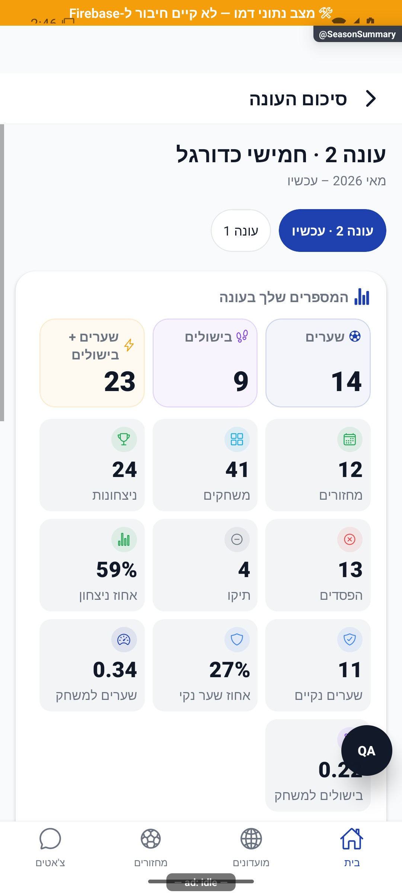

# סיכום עונה ותארים

[להסבר הקצר והפשוט](season-summary.simple.md)

עודכן: 07.10.2026; מקור: `8e8fde5`. מסך `src/screens/profile/SeasonSummaryScreen.tsx`; מסלול `SeasonSummary` עם `groupId` ו־`seasonId` אופציונלי.

## אזורי המסך

שם מועדון ועונה, תאריכים והקשר עכשיו/סגורה, בחירת עונות, המספרים האישיים, הקשרים החברתיים של העונה, תארים אישיים בעונה סגורה וארון תשעת תארי העונה לכל הצופים. סיכום עונה נוכחית אינו מעניק תואר סופי. ארון התארים אינו מוגבל רק לזוכה או למי שהשתתף.

שלושת המספרים המובילים: שערים, בישולים ותרומה של שניהם. אחריהם מחזורים, משחקונים, ניצחונות/הפסדים/תיקו, אחוזים, שערים נקיים, שערים עצמיים ופנדלים לפי נתונים. `hasData` מתבסס על פעילות משחקונים/מחזורים; מחזור ששוחק עם שעון וללא שער עדיין פעילות. שש קטגוריות חברתיות משתמשות באותו חלון עונה.

| פעולה/מצב | מקור | תוצאה |
|---|---|---|
| עונה נוכחית | מונים חיים ומספר עונה עדכני | הגנה מפני תגובה ישנה אחרי החלפת בחירה |
| עונה סגורה | ארכיון מדויק | שמות ותארים קפואים; אין גיבוי למונים חיים |
| ארכיון לא קיים | היעדר רשומה | אי־זמינות וניסיון חוזר, לא עונה אחרת |
| משתתף לשעבר | ארכיון משתתפים | יכולת תיאור היסטורי בלי תלות בסגל החי |
| אין פעילות | חלון קיים בלי השתתפות | מצב מוסבר, ולא מחיקת ארון התארים הכללי |
| שיתוף | מודל העונה ורכיב מחוץ למסך | תמונה ברוחב 340 עם אותם הנתונים |

## קבצים ובדיקות

`src/services/seasonSummaryService.ts`, `seasonHistoryService.ts`; `src/utils/seasonPersonal.ts`, `seasonParticipants.ts`, `seasonAwards.ts`, `seasonMedalTier.ts`; `src/components/community/SeasonTitlesCabinet.tsx`, `SeasonMedal.tsx`; `src/components/summary/SeasonShareCard.tsx`. בדיקות `seasonPersonal`, `seasonTitlesCabinet`, `seasonMedalTier`, `seasonAwards`, `seasonArchiveTable`, `seasonCardParticipants`, `seasonCloseNumbers` ב־`tests/logic`, וכן `tests/rules/seasonSummary.test.mjs`.

## ראיות וגבולות

צילום נתוני דמה מציג עונה 2 נוכחית: 14 שערים, 9 בישולים, 23 תרומות, 12 מחזורים ו־41 משחקונים. זה אינו מסמך ארכיון אמיתי. הצילום מכסה חלק מהמספרים ולא את כל המסך הארוך; ארון תארים, עונה סגורה, אדם בלי פעילות, כשל קריאה ושיתוף לא אומתו כאן.

מקורות 050/053 מציגים מסך עונות ישן ופוסטר; `SeasonHistory` הוסר ותאריו עברו לסיכום. רכיב `SeasonPoster.tsx` שנותר בעץ אינו הוכחה למסלול משתמש פעיל. [מדף תארים אישי](../profile/season-titles.md) הוא מסך נפרד.

## הצעות בלבד

להציג סיכום קצר בראש לפני גלילת המספרים; להשתמש בתנועת מדליה חד־פעמית רק לעונה סגורה ותואר מאומת; להציג משמעות תואר וסף מדגם במגע. לתמוך בדילוג והפחתת תנועה, במיוחד ברגע שבו המשתמש רוצה לשתף.

## פירוט טכני נוסף — זרימה, חישוב ונקודות שינוי

`seasonSummaryService.load` מפריד בין העונה הפעילה וארכיון חתום; `playerRow`, `pairRow` ו־`titlesFor` בונים מידע לאותו משתמש וטווח. שמות עמיתים נפתרים בנפרד; אין להשלים ארכיון ישן באמצעות מספרים חיים מעונה חדשה.

`eligibilityThreshold` הוא `ceil(completedRounds/2)` לפי מחזורי ערב, ומשמש לסף השחקן המצטיין בלבד. ב־13 מחזורים דרושות 7 הופעות; שחקן עם 6 אינו זכאי למצטיין אך יכול לזכות בשערים. ממוצע המצטיין חייב להיות גדול מ־6, וצמד בישולים דורש לפחות 3. תארי פנדלים עונתיים נבחרים לפי מונים, ללא מינימום ניסיונות; אלו אינם דירוג מובילי הפנדלים הכללי שמבוסס על גבול וילסון. שוויון בתואר משמר את כל הזוכים. דרגת המדליה מבוססת על מספר המחזורים שהתקיימו ולא על מספר ההופעות של הזוכה. בדיקות `seasonAwardsMirror` שומרות התאמה לשרת.

הפירוט מתאר את הקוד שנקרא, ולא בדיקת כתיבה או הרשאות בסביבת הייצור. יש לקרוא את הקוד הממוקד וההפרש מאז מקור המיפוי לפני תיקון; בדיקות המוזכרות כאן לא הורצו מחדש לצורך עריכת התיעוד.

## תיקוני עונות — 11.10.2026

`seasonSummaryService.load` ממשיכה לנסות ארכיון לפני קריאת המועדון, גם למשתתף שעזב. אם התבקשה עונה מסוימת והארכיון אינו קיים, נתונים חיים ניתנים רק אם זו באמת `currentId` והעונות פעילות; אחרת מוחזר `null`. עונה היסטורית חסרה לעולם אינה מוצגת במספרים של העונה הנוכחית. ארכיון כולל את כל `pairPages` לפני בניית הצמדים; כשל עמוד מחזיר מצב כשל ולא נתון חלקי. בקוראי ההיסטוריה תקופת `nonSeason` מסוננת מהבחירות וההיכל, אך מצורפת לנתוני כל הזמנים.

השינוי מקומי בלבד. [ראיות, בדיקות ומגבלות](../reviews/2026-10-11-seasons-fixes.md).

## גבולות מידע אישי — 11.10.2026

לאחר אישור הבעלים, קוראי זהות של שחקן אחר משתמשים בהיטל ציבורי בלבד; `users`, `playerStats` ותארים אישיים מוגבלים לבעלים. נתוני זוג אישיים מוגבלים לאחד המשתתפים; סטטיסטיקה מלאה של אדם אחר נשלחת דרך שער הפרטיות בשרת. טבלאות, תוצאות, השוואות וארכיוני מועדון נשארו לפי הרשאת המועדון. פרטי מסלול הקריאה, המקרים והבדיקות ב[גילוי שחקנים ופרטיות](../profile/player-discovery.md). השינוי מקומי וטרם נפרס; אין כאן אימות חדש של תצוגת ייצור.

## כיסוי אישי בזכייה משותפת — 13.10.2026

סגירה חדשה שומרת awards.mvp.coverageByWinner כמפה ממזהה הזוכה אל {rated,of}; מספר הציונים נלקח משורת השחקן הקפואה. coverage משותף נשמר רק אם לכל הזוכים אותו מספר ציונים חלקי. בכרטיס המשותף אין יותר הערת מדגם מרבית כשהמדגמים שונים. titlesFor קורא readSeasonCoverage(a,me), ולכן 3 ו־8 ציונים מתוך 10 מגיעים לזוכים בהתאמה, בלי לשנות את הממוצע או את זהות הזוכים. כיסוי מלא אינו מייצר הערת חוסר. מפה קיימת ללא שורה תקינה לזוכה אינה נופלת לכיסוי של זוכה אחר.

ארכיון ישן בלי המפה ממשיך לקרוא coverage הישן; לא הוסבו מסמכים קיימים. בחידוש סגירה אחרי כשל, הכיסוי המשותף נקרא רק מהארכיון, ולא מהשורות החיות שעשויות להיות מאופסות חלקית. מטא־נתונים חדשים בלבד; אין שינוי הרשאות, זוכים, ציון או ספים. לקוח ישן מתעלם מהמפה; במקרה מדגמים שונים לא יקבל הערה משותפת מטעה בסגירות חדשות.

חמש בדיקות mvpCoverageWinners מפעילות את מקטע הכותב האמיתי, קורא התארים ובניית כרטיס מחודש: מדגמים שונים/זהים, כיסוי מלא, מפה פגומה או שורה חסרה, תאימות ישנה וחידוש עם שורות חלקיות. אין כתיבת ארכיון או צילום מסך עם נתוני ייצור. נדרשים עדכון לקוח ופריסת שרת מאושרים כדי להפעיל את התיקון בייצור.

הכיסוי 3/10 ו־8/10 אומת גם בתוך ארכיון Firestore מקומי בסבב ההמשך. חידוש סגירה לאחר איפוס חלקי שומר את הפרסים, האורך והתאריכים הקפואים; גם בקשת חידוש שטוענת לעונה 4 ו־99 מחזורים אינה מחליפה את עונה 1 בעלת 10 מחזורים. זו ראיית מסד ללא הרצת המסך או תעבורת פונקציה פרוסה. [בדיקות האינטגרציה ומגבלותיהן](../../audits/2026-10-13-statistics-firestore-integration.md).

## החלטות הבעלים — 13.10.2026

תארי הפנדלים בעונה נקראים מלך הבקעות הפנדלים ומלך עצירות הפנדלים, לפי מספר הפעולות. לא משתנים זוכים היסטוריים.

`seasonTitleNames` משתנה במלל בלבד; `computeSeasonAwards` נשאר לפי מספר הבקעות/עצירות. בדיקה מול מוביל מועדון עם 8/10 לעומת 10/30 מוכיחה הבחנה מכוונת בין מדגם מוצלח לכמות עונתית. כיסוי בישולים ושערים נקיים אישי חסר אינו משוחזר מ־rounds. אין כתיבה לארכיונים קיימים. צילום מסביר את ההבחנה בדמו ואינו צילום סיכום עונה מלא.

השינוי מקומי וטרם נפרס. [פירוט הבדיקות והמעבר](../../changes/2026-10-13-approved-statistics-policy.md).

