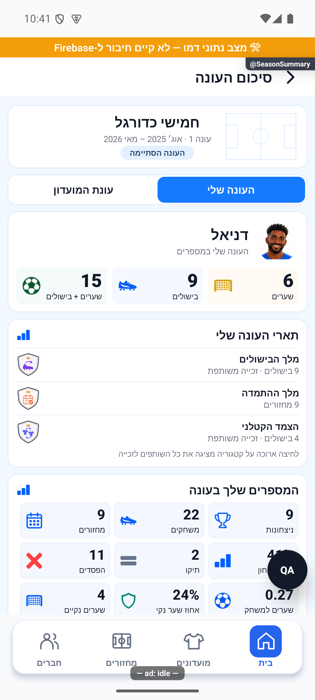
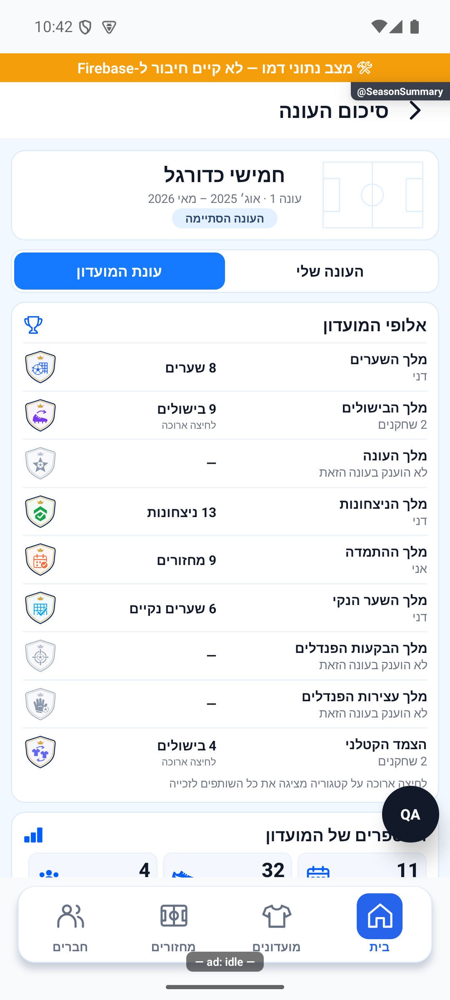

# מסכמים עונה

## אימות מול שרת אמיתי והגבלת המתנה — 20.10.2026

במועדון הבדיקות נבדקו מול השרת האמיתי הפעלת עונה עם שבעה מחזורים, סגירה ידנית, חלוקת שמונה תארים ופתיחת עונה שנייה ריקה. הנתונים נשמרו בארכיון ובכל הזמנים. שירותי העונות נפרסו באישור; תיקון נוסף בלקוח מציג אפשרות לנסות שוב אחרי30 שניות של קריאה תקועה, והוא עדיין דורש הפצת לקוח. לא המתנו24 שעות בפועל ולא בדקנו כאן סגירה של עונה קצרה.

[הבדיקה, המקור, הצילומים והמגבלות](../reviews/2026-10-20-seasons-live.md).

## תיקון פערי העונות — 20.10.2026

כל חמשת הפערים בביקורת טופלו מקומית: אכיפת סוף חלון התיקונים, חסימת הארכה מאוחרת, אימות ללא מועד, התאמת מועד לשיוך ורענון הסטטיסטיקות. תוקנה גם פתיחת סיכום עונה פעילה שנכשלה מול ההרשאות. אין שינוי בכללי התארים או בשלוש בחירות ההפעלה. אפשר לדחות מחזור שלא התקיים גם בלי להמציא לו תאריך; אישור שהתקיים עדיין דורש מועד. התיקון טרם הופץ.

[דוח תיקונים, בדיקות ומגבלות](../reviews/2026-10-20-seasons-fixes.md).

[לפירוט המעמיק](season-summary.md)

בוחרים עונה בחלון הסטטיסטיקה ופותחים את סיכום העונה. הסיכום נשאר על אותה עונה, בלי בחירה נוספת בראש המסך.

יש שתי לשוניות:

- **העונה שלי** — שערים, בישולים, תארים אישיים, כל המספרים שלכם, המיקום במועדון והאנשים ששיחקתם איתם ומולם.
- **עונת המועדון** — אלופי המועדון בראש, כל מספרי המועדון במקום אחד והצמדים הבולטים, כולל הצמד עם אחוז הניצחונות הגבוה ביותר כשיש מספיק משחקים.

העיצוב תואם לכרטיסים של המועדון, עם עברית מימין לשמאל ואייקונים צבעוניים במקום מדליות מקום ראשון, שני ושלישי. המיקום האמיתי שלכם עדיין מוצג במספרים.

אם כמה שחקנים חולקים תואר, רואים כמה שחקנים זכו בו. לחיצה ארוכה על הקטגוריה מציגה את כולם, גם כשיש להם אותו שם. בעונה שעדיין נמשכת מוצגים מובילים זמניים; התארים הסופיים נקבעים רק כשהעונה נסגרת.

סיכום עונה סגורה משתמש בנתונים ובשמות שנשמרו עבורה. כשנתון לא תועד מוצג קו מפריד. שיא המחזור הפורה מתייחס רק למחזורי העונה שיש להם סיכום מתועד. אחוז ניצחונות של צמד דורש לפחות עשרה משחקים יחד.

כל לשונית מאפשרת לשתף תמונת סיכום מתאימה: אישית או של המועדון.

עודכן מקומית ב־18.10.2026. המסכים ותמונות השיתוף נבדקים בנתוני דמה, ואינם צילום של נתוני המועדון האמיתי. העדכון טרם הופץ לחנות.

## סמלים קבועים לכל תואר — 18.10.2026

לתארי העונה יש עכשיו מגן קטן עם כתר עדין. לכל תואר ציור וצבע משלו, ואותו מגן מופיע בסיכום האישי, בסיכום המועדון, בתמונות השיתוף ובתארים האישיים. תואר שלא הוענק בעונה הזאת מוצג באפור עם הסבר. שמות התארים, הזוכים והמספרים נשארו כפי שהיו.

השינוי נבדק מקומית בנתוני דמה וטרם הופץ לחנות.

התצוגה הותאמה מחדש לסקיצות: אייקונים צבעוניים כתמונות קטנות, אריחי מספרים נמוכים, כותרת עונה קומפקטית ושורות קטנות לאנשים ולצמדים. מגני התארים נשמרו. המחזור הפורה וחלקו של מלך השערים מוצגים יחד מתחת למספרי המועדון. ליד ההערות הקצרות אפשר לפתוח הסבר מלא בכפתור המידע.

## התאמה לעונות החדשות — 19.10.2026

המצטיין מתגלה רק בסיום העונה. אם אין שחקן שהשתתף במחצית מהמחזורים או שאין ציון תקף, הסיכום מסביר מדוע אין מצטיין. ציונים חסרים אינם אפס; שוויון בממוצע המעוגל לשתי ספרות מזכה את כולם. התארים המצטברים אינם דורשים מינימום נוכחות.

השינוי מקומי בלבד. הבדיקות והגבלות האימות מפורטים ב[מסמך המעמיק](season-summary.md).

## מספר הציונים של המצטיין — 19.10.2026

בסיום העונה מוצג כמה ציוני מחזור נכללו בממוצע המצטיין, גם אם יש ציון בכל מחזור. כשיש זכייה משותפת ומספר הציונים שונה, אפשר לפתוח את רשימת הזוכים בלחיצה ארוכה ולראות את המספר של כל אחד. לפני הסיום מופיע שהמצטיין יתגלה בסוף העונה. השינוי מקומי בלבד; התצוגה נבדקה במתאם דפדפן, ללא אימות מחוות במכשיר.

הבדיקות הכוללות של העדכון המקומי עברו; האימות החזותי במכשיר עדיין לא הושלם. מסלול ההפעלה עודכן כך שכל המחזורים ללא עונה זמינים לבחירה, כולל ניסיונות שבוטלו.

גם שמות שנשמרו לשחקנים שכבר אינם במועדון נשמרים בעת הכללת פעילות ללא עונה בתחרות חדשה; הנתונים אינם נספרים פעמיים.

## שם המצטיין וסדר התארים — 19.10.2026

תואר המצטיין נקרא כעת ״השחקן המצטיין״ ומופיע ראשון ברשימת התארים. יתר התארים שומרים על סדרם. השם משותף לכל המקומות המציגים את התואר; כללי הזכייה והסתרתו לפני הסיום נשמרו. השינוי מקומי וטרם הופץ.

## הבהרת התצוגה וסיכום אישי — 19.10.2026

הוסרו שורת ההסבר על האחוזים בסיכום האישי והשורה ״נתוני המועדון בעונה שנבחרה״ בסיכום המועדון. פרטי השותף מציינים ״23 משחקים באותה קבוצה, 15 מהם ניצחתם״. פרטי היריב מציינים במפורש כמה ניצחת וכמה הפסדת, ומוסיפים תיקו כשיש. האוואטר מופיע מימין לשם ולקטגוריה של מובילי המועדון; בזכייה משותפת מופיעים עד שני אוואטרים והרשימה המלאה נשארת בלחיצה ארוכה. כפתור הכניסה מעוצב ככרטיס לבן עם פינות מעוגלות, אייקון כחול וחץ, ונקרא ״סיכום העונה שלי״. בחירת העונה נקבעת במסנן הקיים. השינוי מקומי וטרם הופץ.

## מלך הניצחונות לפי אחוז — 19.10.2026

״מלך הניצחונות״ בעונות החדשות נקבע לפי אחוז הניצחונות מתוך כל המשחקים שהשחקן שיחק בעונה, כולל תיקו במכנה. חובה להשתתף בלפחות מחצית ממחזורי העונה, בעיגול כלפי מעלה: 7 מתוך 13. האחוז מעוגל לשתי ספרות אחרי הנקודה; שוויון אחרי העיגול מזכה את כל השותפים. אין צורך בציון מחזור לצורך תואר זה. בלי זכאי עם נתונים תקפים ולפחות ניצחון אחד אין תואר, ובסיכום מוצגת הסיבה. יתר התארים המצטברים שומרים על הכללים הקיימים, ללא סף נוכחות. התארים שכבר נסגרו נשארים כפי שנקבעו. השינוי מקומי וטרם הופץ.

## אוואטרים לכל המובילים משמאל לטקסט — 20.10.2026

האוואטר מופיע כעת משמאל לכותרת ולשם בכל שורת תואר שיש בה מוביל. נתוני הדמה של כל התארים, הפעילים והסגורים, הושלמו עם מזהי השחקנים; קודם המזהים היו חסרים ברוב השורות ולכן הוצג אוואטר רק במלך הניצחונות. תואר ללא מוביל והמצטיין החסוי אינם מציגים אוואטר. השינוי מקומי וטרם הופץ.

## אימות באימולטור המקורי — 20.10.2026

סיכום עונת המועדון הוצג באימולטור אנדרואיד עם קוד המקור המעודכן ונתוני דמה. אומת אוואטר משמאל לכותרת ולשם בכל חמש הקטגוריות שיש בהן מוביל. [צילום עדכני מהאימולטור](../screenshots/season-avatars-left-android-2026-10-20.png). האימות משלים את מגבלת הדפדפן שצוינה קודם; אין כאן אימות נתוני ייצור או הפצה.

## בחירה סופית: אוואטרים מימין — 20.10.2026

לפי בחירת הבעלים האוואטרים הוחזרו לימין הכותרת ושם השחקן בכל תואר שיש בו מוביל. הצגת אוואטר לכל המובילים נשמרה. בחירה זו מחליפה את ניסיון ההצבה משמאל שתועד קודם. השינוי מקומי וטרם הופץ.

## אימות תצוגה מקורי אחרי התיקון — 20.10.2026

מסכי הסטטיסטיקות וסיכום העונה נפתחו ונבדקו באימולטור אנדרואיד עם נתוני דמה. בדיקות הנתונים נערכו במסד מבודד בנפרד; לא שונו נתוני מועדון אמיתי. הצילומים והמגבלות במסמך המעמיק.

## תלות במלל המשותף — 20.10.2026

קובץ המלל המשותף השתנה במסגרת כרטיס העונה בבית. מסך סיכום העונה והנתונים שלו לא השתנו.

נוסח הכרטיס עודכן לגרסה הסופית; מסך סיכום העונה נשאר ללא שינוי.
